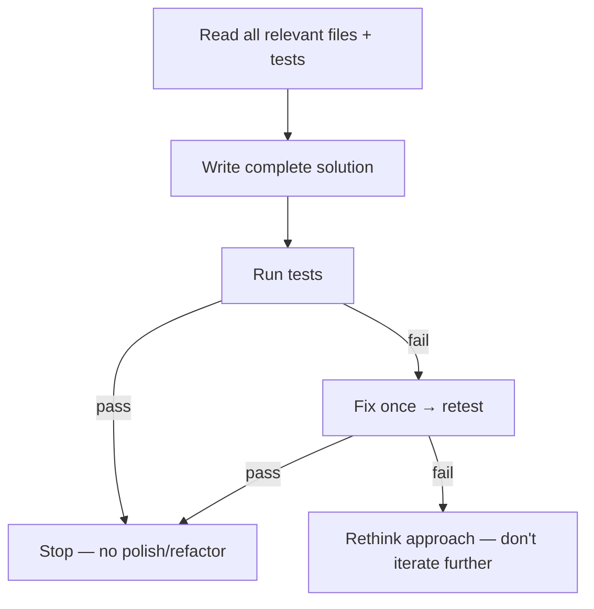
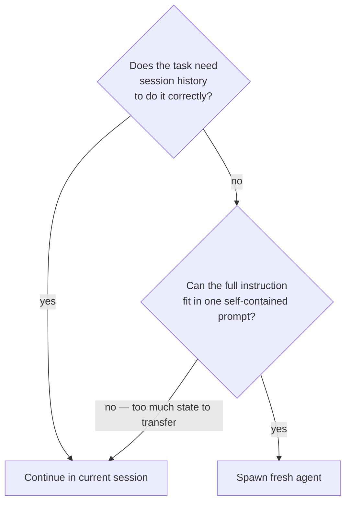

# Tokenomy

Goal: spend the fewest tokens that still produce correct, complete work. These are defaults
— skip any rule when it would cost correctness or the user asked for full detail.

## File operations
- **Find before you read.** Grep for the symbol or string, then read a window
  (`offset`/`limit`) instead of pulling a whole file.
- **Filter large logs / data / JSON at the source** (`tail`, `grep`, `jq`, `wc -l`) rather
  than reading raw. A failing test log becomes "3 tests failed: …", not 5,000 pasted lines.
- **Delegate broad fan-out** ("where is X handled", sweeps across many files) to a
  sub-agent / exploration agent if available; keep only the conclusion in your context.
- **Don't re-read after editing.** Write/Edit tools confirm success inline — reading the
  file back burns context for no gain.
- **Batch edits to the same file** — round trips risk partial state; group into one atomic call.
- **No explanatory comments in code.** Comment the WHY (hidden constraint, workaround,
  non-obvious invariant), never the WHAT — comment lines add tokens to every future read.
- **When choosing how to search, read, or diff: consult `references/search-and-read.md`** — covers grep, windowing, logs, git diffs, and visual state.

## Output
Summarize, don't dump. Report findings as structure (counts, the few relevant lines), not
raw paste. Skip narrating steps you're about to take and re-stating settled plans. Give
full output when the user asks.

When deciding how much detail to carry forward:

| Rule | When |
|---|---|
| **Never suppress** | Output from the current turn; output still driving an active decision |
| **Consider summarizing** | Outputs from 3+ turns ago whose key points are already extracted |
| **Always suppress** | Repeated identical outputs; boilerplate already seen; outputs you've already summarized |

These output patterns waste tokens on every response — delete them:

| Pattern | Fix |
|---|---|
| Sycophantic opener ("Sure! Great question!") | Delete. Lead with answer. |
| Prompt restatement ("You're asking about X…") | Delete. Answer directly. |
| Closing fluff ("Let me know if you need anything!") | Delete. Stop after the answer. |
| Unsolicited suggestions ("You might also want to…") | Delete unless asked. |
| AI disclaimers ("As an AI model…") | Delete entirely. |
| Verbose preamble ("I'll help you with that…") | Delete. Start with the action. |

## One-pass coding

Each failed iteration re-reads errors and re-explains context — prevent them:



## Fresh agents vs. continuing the session

A fresh agent starts with an empty context window — no accumulated output or prior turns.
For self-contained sub-tasks this is dramatically cheaper than continuing a long session.

**Core test:** Can you write a complete, accurate prompt without referencing "what we just
found" or "the error from earlier"? If yes — the prompt *is* the context; spawn fresh.



| Isolated → spawn fresh | Needs context → continue |
|---|---|
| Sweep / exploration across many files | Builds on a partial result from this session |
| Read-and-summarize a specific artifact | Responds to an error discovered this session |
| Review a PR diff or log file | Follow-up after a failed attempt |
| Any task you'd fully re-explain anyway | Part of a multi-step plan already in progress |

**Before writing any agent spawn prompt: read `references/sub-agent-prompts.md`.**

## Documentation you write or edit
**Read `references/doc-authoring.md` before editing any agent-facing doc** — audience
detection rules, Mermaid guidance, anti-patterns, examples.

## Context cost estimates
Biggest lever: MCP server schemas load every session whether used or not.

| Component | Approx tokens (per item) |
|---|---|
| Skill name + description | 25 – 150 |
| CLAUDE.md (typical project) | 200 – 1,000 |
| MCP server schema (1–3 tools) | ~100 – 600 |
| MCP server schema (10+ tools) | ~1,000 – 5,000+ |

Quick estimate: `wc -w <file>` × 1.3 ≈ tokens (English prose). Code and JSON tokenize
at roughly 0.5–1 word per token — treat the formula as a lower bound for mixed files.

## Audit: find tooling that wastes startup tokens (runtime-specific)
The bundled script compares configured **MCP servers** against actual usage history. Config
discovery and transcript format are runtime-specific; the script auto-detects common
locations or accepts explicit paths.

Locate the script if your runtime does not expose the skill base directory directly:

```bash
find ~/.claude -name "audit-usage.py" 2>/dev/null | head -1   # Claude Code / similar
# For other runtimes: check your skills installation directory
```

Then run:

```bash
python3 <skill_dir>/scripts/audit-usage.py                         # auto-detect
python3 <skill_dir>/scripts/audit-usage.py \
    --mcp-config path/to/mcp.json --transcripts 'path/to/*.jsonl'  # other runtimes
python3 <skill_dir>/scripts/audit-usage.py --json                  # machine-readable
```

Present the report concisely, leading with the actionable part: **configured MCP servers
never invoked** are the prime candidates to remove from their config. Do not edit config
yourself — recommend, and let the user decide. If no usage history is found, say so (and
that usage can't be determined for this runtime) rather than implying everything is unused.
