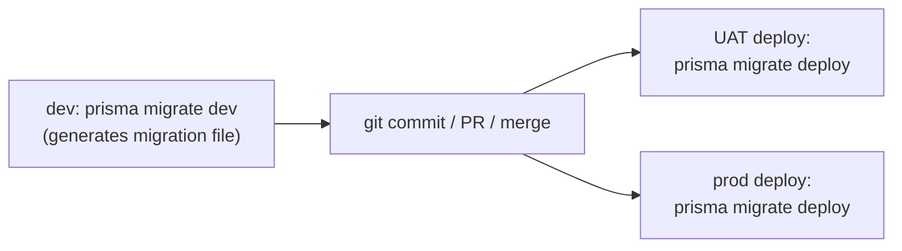

# TailorTales — Roadmap

> Single source of truth for project scope, decisions, and progress.
> Update this file whenever scope changes, a decision is made, or a phase completes.

---

## 1. Project Overview

**TailorTales** is a SaaS service that generates short (5–20 page), customized PDF books and comics for children. Target audience: parents who want to create personalized educational content that answers their child's "Why?" / "How?" questions in an age-appropriate, engaging way.

### Output formats

- **Book** — page-based; the LLM composes from a set of page layouts (cover, text-only, text + illustration, full-page illustration, final) chosen for narrative pacing. Most pages carry one illustration.
- **Comic** — panels with speech bubbles, multiple illustrations per page. _(Generation deferred to Post-MVP — see Deferred Decision #6.)_

### Customization inputs (per generation)

- **Required:** child question, child age, output format (book/comic), length (5/8/12/16/20 pages), art style, language.
- **Optional:** child interests/hobbies, Character description for visual consistency.
- **Future (v2):** child photo / parent photo reference images for character likeness, with explicit guardian consent and retention controls.

---

## 2. Stack & Architecture Decisions

| Area                  | Decision                                                                                                                                                  |
| --------------------- | --------------------------------------------------------------------------------------------------------------------------------------------------------- |
| Repo layout           | Monorepo: `frontend/` + `backend/`, **pnpm workspaces** (no Turborepo for now)                                                                            |
| Backend               | Nest.js (TypeScript), REST API with OpenAPI auto-generation                                                                                               |
| Frontend              | Next.js (React, TypeScript), CSS Modules, **Mantine** UI library                                                                                          |
| State management (FE) | React Query (server state) + Zustand (UI state)                                                                                                           |
| Database              | PostgreSQL via **Prisma** ORM                                                                                                                             |
| Queue                 | **BullMQ** (Redis-backed)                                                                                                                                 |
| Object storage        | **MinIO** for dev/local, **AWS S3** for production                                                                                                        |
| LLM (text)            | **OpenRouter** — model configurable via `OPENROUTER_TEXT_MODEL`; local/CI default to stub providers (`USE_AI_STUBS`) to avoid spend                       |
| Image generation      | **OpenRouter** (unified with text) — `google/gemini-3.1-flash-image` or `openai/gpt-5.4-image-2`, configurable via env; base64 output uploaded to storage |
| PDF generation        | **Puppeteer** (HTML → PDF)                                                                                                                                |
| Auth                  | **Google OAuth only** at MVP                                                                                                                              |
| Payments              | **Paddle**                                                                                                                                                |
| Email                 | **Resend** (decided in Phase 5 — story completion notification)                                                                                           |
| Real-time progress    | **SSE** (Server-Sent Events)                                                                                                                              |
| Notifications         | Email + in-app (bell + toast)                                                                                                                             |
| Testing               | Vitest + React Testing Library                                                                                                                            |
| Containerization      | Docker + docker-compose for dev; Dockerfiles deployed via **dokploy**                                                                                     |
| CI/CD                 | GitHub Actions (lint + type-check + test) — minimal at start                                                                                              |
| Observability         | Pino logs only at MVP (no Sentry/OTel for now)                                                                                                            |
| Compliance            | GDPR (EU-only target audience at MVP)                                                                                                                     |

---

## 3. Glossary

> Several concepts have similar names. This table is the canonical disambiguation — use these exact terms in code, docs, API, and UI.

| Term               | What it is                                                                                                                                                                                                                                                                                                                                                                                                                                                             |
| ------------------ | ---------------------------------------------------------------------------------------------------------------------------------------------------------------------------------------------------------------------------------------------------------------------------------------------------------------------------------------------------------------------------------------------------------------------------------------------------------------------- |
| **Story**          | DB entity. A book or comic (by `type`), owned by a User, referencing a Child. Owns ordered `Page` rows.                                                                                                                                                                                                                                                                                                                                                                |
| **Page**           | DB row. One page of a Story. The **materialized, validated Story Plan** and the source the PDF is rendered from (the PDF is a derived artifact).                                                                                                                                                                                                                                                                                                                       |
| **PageTemplate**   | Typed **code** config in `page-templates.config.ts` (no DB model). The contract shared by prompt builder, validator, and renderer. Each entry: `htmlFile`, `type`, `role (cover\|interior\|final)`, `narrativePurpose`, `maxChars` (plain object keyed by zone name), `images` (array of `{ name, aspect, size }` — pixel dimensions for the image generation API). Config is a plain `Record<string, IPageTemplate>` keyed by template name. Named e.g. `book-cover`. |
| **Story Plan**     | The structured JSON the **LLM returns** during generation: `title`, `styleAnchor`, and per page `{ template, text, illustration.prompt }`. Validated, then persisted as `Page` rows. Not a DB entity, not stored as a blob.                                                                                                                                                                                                                                            |
| **StoryBlueprint** | DB entity. Admin-authored **narrative DNA** (`systemPrompt` with XML markers). Auto-selected by story `type` to guide planning. Distinct from "Story Plan" — the blueprint shapes the prompt; the plan is the output.                                                                                                                                                                                                                                                  |
| **Character**      | DB entity. A reusable visual identity owned by a User, usually linked to a Child. MVP source is text description/manual generation; Post-MVP source may include reference images. Used to produce a stable per-story `styleAnchor`.                                                                                                                                                                                                                                    |
| **styleAnchor**    | Text description of recurring characters + style, generated once and prepended to every image prompt for cross-page consistency. Stored on `Story`.                                                                                                                                                                                                                                                                                                                    |
| **ArtStyle**       | DB entity. The visual style (`promptPrefix`) the parent picks in the workshop (e.g. Watercolour).                                                                                                                                                                                                                                                                                                                                                                      |
| **PricingTier**    | DB entity. A subscription tier (Phase 9). Named `PricingTier`, **not `Plan`**, to avoid collision with "Story Plan" / "Phase Plan".                                                                                                                                                                                                                                                                                                                                    |
| **Job**            | DB entity + BullMQ job. Tracks generation pipeline `stage`/`status` for SSE. `type` = `generation \| regeneration`. Progress is derived at serve-time from completed page count — no stored `progress` field.                                                                                                                                                                                                                                                          |
| **AiClient**       | The single OpenRouter wrapper for both text and images. `AiStubClient` is the offline/CI stand-in (`USE_AI_STUBS`).                                                                                                                                                                                                                                                                                                                                                    |

---

## 4. Domain Model (high level)

| Entity             | Notes                                                                                                                                                                                                                                                                                                                                                                                                                                                                                                                                                                                                                                                                                                                                                                                                                     |
| ------------------ | ------------------------------------------------------------------------------------------------------------------------------------------------------------------------------------------------------------------------------------------------------------------------------------------------------------------------------------------------------------------------------------------------------------------------------------------------------------------------------------------------------------------------------------------------------------------------------------------------------------------------------------------------------------------------------------------------------------------------------------------------------------------------------------------------------------------------- | -------- | ----------------------------------------------------------------------------- |
| **User**           | Google OAuth identity, role (USER / ADMIN).                                                                                                                                                                                                                                                                                                                                                                                                                                                                                                                                                                                                                                                                                                                                                                               |
| **Child**          | Belongs to User. Fields: name, birthdate, gender, interests, optional avatarUrl for UI avatar/display only. Character likeness belongs to `Character`, not `Child`.                                                                                                                                                                                                                                                                                                                                                                                                                                                                                                                                                                                                                                                       |
| **Character**      | Belongs to User, optionally references Child. Fields: name, description, source (`MANUAL_DESCRIPTION` at MVP; `REFERENCE_IMAGE` Post-MVP), referenceImageKey? (Post-MVP), generatedPreviewImageKey?, consentAt? (required before storing child/person reference images Post-MVP), createdAt, updatedAt. Story creation selects the child's default Character; the generation pipeline snapshots it into `Story.styleAnchor` so older stories stay stable if the Character changes later.                                                                                                                                                                                                                                                                                                                                  |
| **ArtStyle**       | Admin-managed. Fields: id, name, slug, thumbnailUrl, promptPrefix, isActive, order. Seeded with 8 styles.                                                                                                                                                                                                                                                                                                                                                                                                                                                                                                                                                                                                                                                                                                                 |
| **Story**          | Unified entity for books AND comics, distinguished by `type` field. Belongs to User, references Child and optionally the Character snapshot used at creation time. Key fields: `question`, `pageCount`, `artStyleId`, `language (Language enum — EN\|RU)`, `title?` (LLM-generated, Phase 5), `styleAnchor?` (recurring-character + style description for cross-page image consistency, Phase 5; generated from Character when present), `coverImageKey?`, `pdfKey?` (S3 keys — never URLs; signed at serve time via StorageService). `isPublic boolean (default false)` — set via opt-in in rating flow.                                                                                                                                                                                                                 |
| **Page**           | Belongs to Story, ordered. `text` is optional — both book and comic pages may be illustration-only. Contains illustration key(s) + chapter title + `illustrationPrompt?` (prompt used to paint the page; reused by Phase 8 regeneration). `layout` stores the PageTemplate name (e.g. `book-cover`). Page rows are the materialized Story Plan and the source the PDF renders from. Composite unique on `(storyId, order)`.                                                                                                                                                                                                                                                                                                                                                                                               |
| **StoryBlueprint** | Pre-defined story blueprint created by Admin (previously named `Template`). `systemPrompt` carries structured LLM guidance using XML markers (e.g. `<intro_prompt>`, `<climax_prompt>`). `coverImageKey` + `previewPageKeys` are S3 keys reserved for user-facing preview (Post-MVP). Auto-selected by the generation pipeline based on `StoryType`; user-facing selection deferred to Post-MVP.                                                                                                                                                                                                                                                                                                                                                                                                                          |
| **PageTemplate**   | Typed page layout specification — single source of truth for the LLM prompt builder, the response validator, and the PDF renderer. Defines A5 page (148×210 mm = 1748×2480 px at 300 DPI), `role (cover \| interior \| final)`, `narrativePurpose` (when the LLM should pick it), text zones (`maxChars` per named zone, type: `body \| caption \| speech-bubble \| narration-box`), and image zones — each carries a layout `zonePx` (PDF placement) plus an `aspectRatio` + `sizeTier` used for image generation (the LLM never emits these). Lives in `page-templates.config.ts` — no DB model. **Book layouts (MVP):** `book-cover`, `book-text`, `book-text-image`, `book-full-image`, `book-final`. **Comic layouts (Post-MVP):** `comic-cover`, `comic-2-panel`, `comic-3-panel`, `comic-4-panel`, `comic-splash`. |
| **PricingTier**    | Subscription tier definition (named `PricingTier`, not `Plan`, to avoid collision with "Story Plan" and "Phase Plan"). Fields: id, name, paddleProductId, paddlePriceId (Paddle.js checkout opens with a price id), priceMonthly (euro cents), pagesPerMonth, regenerationsPerMonth, childrenLimit (null = unlimited), retentionDays (null = forever), watermark, order.                                                                                                                                                                                                                                                                                                                                                                                                                                                  |
| **Subscription**   | Paddle-backed. Fields: id, userId (unique — every user owns exactly one row, free tier by default), pricingTierId, paddleSubscriptionId, paddleCustomerId (kept after cancel for portal/invoices), status (ACTIVE                                                                                                                                                                                                                                                                                                                                                                                                                                                                                                                                                                                                         | PAST_DUE | CANCELED), cancelAtPeriodEnd, currentPeriodEnd, pagesUsed, regenerationsUsed. |
| **Rating**         | Belongs to Story + User. Fields: score (1–5), comment (optional). One per user per story (upsert).                                                                                                                                                                                                                                                                                                                                                                                                                                                                                                                                                                                                                                                                                                                        |
| **Job**            | Tracks generation pipeline state and progress for SSE. One BullMQ job per story; per-page image generation fans out inside the job (capped concurrency). `stage` field drives the progress UI.                                                                                                                                                                                                                                                                                                                                                                                                                                                                                                                                                                                                                            |
| **Notification**   | In-app notification per User. Fields: id, userId, type, payload (JSON), readAt?, createdAt.                                                                                                                                                                                                                                                                                                                                                                                                                                                                                                                                                                                                                                                                                                                               |

**Unified naming:** `Story` covers both book and comic.

---

## 5. Business Rules & Policies

- **Pricing model:** page credits. 1 book page = 1 credit. 1 comic page = 2 credits.
- **Tiers:** Free Chapter (€0 · 1 tale/month up to 12 pages · watermarked) · Story Hour (€5 · 60 pages/month) · Family Workshop (€10 · 150 pages/month). Decided Phase 6 after AI cost analysis.
- **Generation:** fully automated end-to-end. User submits customization → receives final PDF.
- **Concurrent generation:** 1 active generation job per user at MVP.
- **Character consistency:** every generated story uses a per-story `styleAnchor`; when a Child has a Character, that Character is the canonical source for recurring visual identity.
- **Regeneration:** user can regenerate specific pages (text / illustration / both) with an optional prompt. Limited per subscription tier.
- **Free tier:** PDFs are watermarked. Retention policies differ per tier (free PDFs may expire).
- **Content safety:** strict — text and image moderation pre-delivery. Child-friendly only.
- **Age-adaptive content:** LLM adapts vocabulary and complexity based on child's age.
- **Localization:** UI + generated content in EN and RU.
- **Subscriptions only for registered users.**
- **Public stories:** opt-in only. Parent explicitly agrees when rating a story. Appears on landing page.
- **Admin:** seeded via DB or admin-only invite flow. Has a dedicated admin panel.

---

## 6. MVP Scope

### IN

- ✅ Google OAuth, USER + ADMIN roles
- ✅ Multiple children per user (capped by PricingTier's `childrenLimit`)
- ✅ Stories: single entity with `type` (BOOK | COMIC); **book generation only** at MVP — see comic note below
- ✅ StoryBlueprints (admin-created; auto-selected during generation by StoryType; user-facing selection Post-MVP)
- ✅ Character entity for repeatable visual identity across pages/stories; MVP supports text-description/manual generation, not photo likeness
- ✅ Generation pipeline — **book** (text + images both via OpenRouter, one provider)
- ✅ Customization: question, age, format, length, art style (from DB), language
- ✅ 6 static question suggestion chips in workshop form ("the jar")
- ✅ 1 concurrent generation per user; workshop nav routes to generation page if job active
- ✅ Real-time generation progress via SSE (per-page completion events)
- ✅ Limited page regeneration per tier (with optional user prompt)
- ✅ Paddle subscriptions (page credits model, 3 tiers)
- ✅ Ratings (score + comment) + opt-in public sharing (`Story.isPublic`)
- ✅ Toast (transient) + bell (persistent inbox) notifications
- ✅ Email notifications (story completed, story failed, subscription events) via Resend
- ✅ Admin panel (users, stories review, templates, art styles, ratings, basic stats)
- ✅ Content moderation (text + image)
- ✅ GDPR baseline: privacy/data page, data export, account deletion, S3 object cleanup, retention cleanup, and launch copy/legal review gate
- ✅ Watermark on free tier
- ✅ EN + RU localization
- ✅ `/account` settings page (Profile, Children, Subscription, Notifications, Language, Privacy & data)
- ✅ Delete account (GDPR) including generated PDFs/images and reference-image objects where present
- ✅ Schema reserved for reference-image input — Character can gain `referenceImageKey` later without changing the story-generation contract

### OUT (Post-MVP / v2)

- ❌ **Comic generation** — the data model (`Story.type`, comic StoryBlueprint seed), the workshop Comic toggle ("coming soon"), and the comic PageTemplate slots are kept in place; only the generation path (panel contract, speech-bubble rendering, multi-image-per-page) is deferred. The Phase 5 engine is built comic-ready so this is additive. See Deferred Decision #6.
- ❌ Magic email link auth
- ❌ Photo/reference-image input for character likeness — deferred, but **no longer assumed to require a provider switch**: OpenRouter image models (e.g. Nano Banana Pro) support reference images / identity preservation, and the `AiClient.generateImage` signature reserves a `referenceImageKeys?` seam. Before shipping, add explicit guardian consent, upload/delete UX, retention rules, and privacy-copy updates.
- ❌ Referral program
- ❌ Public story sharing gallery (beyond opt-in landing page display)
- ❌ Advanced analytics & observability (Sentry, OTel)
- ❌ Email/password auth, Apple OAuth, etc.
- ❌ Export library (ZIP of all user PDFs)
- ❌ "From the Wonder Jar" AI-personalized question suggestions (requires story history analysis)
- ❌ Mobile apps
- ❌ More languages (French, Estonian, etc.)

---

## 7. Navigation Decisions

### Public header (unauthenticated)

`[Logo] TailorTales` · How it works · Pricing · `Sign in` · **Begin a tale →** (CTA button)

### Private header (authenticated)

`[Logo] TailorTales` · **Library** · **Workshop** · `[🔔]` · `[Avatar] Name / Plan`

### Footer (both states)

Privacy · Contact _(both static pages)_

---

## 8. Process & Documentation Rules

- **ROADMAP.md is the single source of truth.** Update it on every scope change or decision.
- **DESIGN.md** documents all UI/UX decisions from design screen reviews. Update after each design review session.
- **Per-phase docs (staging) → durable docs (lasting).** While a phase is in progress, capture what it built in `_docs/phase-N-<name>.md` following `TEMPLATE.md` (summary, what was added, structure, commands, env/migrations, gotchas). These are temporary working notes. At documentation phases (7, 14, …) the accumulated phase docs are **consolidated into the durable docs** (`architecture/`, `api/`, `guides/`, `decisions/`) and the `phase-N` files removed. Durable docs are **phase-agnostic** and human-facing — the lasting source of truth; anything unbuilt is "planned (see ROADMAP)".
- **Rules revision:** after each phase, review and propose updates to `CLAUDE.md` and `.claude/rules/*.md` based on what was learned. **Each revision requires developer approval before commit.**
- **Phase completion gate:** a phase is NOT complete until acceptance checks pass AND its `_docs/phase-N-<name>.md` is written. No half-finished phases in `main`.

---

## 9. Deferred Decisions & Tech Debt

> Items explicitly deferred during development. Each entry records **what**, **why it was deferred**, and **when to revisit**.
> New items require developer approval before being added.

| #   | Item                                                               | Deferred reason                                                                                                                                                                                                                                                                                                                                                                                                                                                                                                                                                                                                                                                                                                                                                                                                                                                                                                                                                              | Revisit at                 |
| --- | ------------------------------------------------------------------ | ---------------------------------------------------------------------------------------------------------------------------------------------------------------------------------------------------------------------------------------------------------------------------------------------------------------------------------------------------------------------------------------------------------------------------------------------------------------------------------------------------------------------------------------------------------------------------------------------------------------------------------------------------------------------------------------------------------------------------------------------------------------------------------------------------------------------------------------------------------------------------------------------------------------------------------------------------------------------------- | -------------------------- |
| 1   | Refresh tokens + server-side logout                                | httpOnly + SameSite:lax sufficient for MVP; Google re-login is frictionless; current logout is client-side only (JWT stays valid up to 7d after cookie deletion). Refresh tokens require DB/Redis storage, rotation endpoint, and frontend handling — complexity not justified at MVP.                                                                                                                                                                                                                                                                                                                                                                                                                                                                                                                                                                                                                                                                                       | Post-MVP                   |
| 2   | Magic email link auth                                              | Requires email provider (already decided: Resend in Phase 5). Added as Post-MVP auth option alongside Apple OAuth.                                                                                                                                                                                                                                                                                                                                                                                                                                                                                                                                                                                                                                                                                                                                                                                                                                                           | Post-MVP                   |
| 3   | ~~Exact comic credit rate~~ ✅ Phase 9                             | Confirmed: 2 credits/page (`CREDITS_PER_PAGE` in `subscriptions.constants.ts`); comics still post-MVP.                                                                                                                                                                                                                                                                                                                                                                                                                                                                                                                                                                                                                                                                                                                                                                                                                                                                       | Phase 9                    |
| 4   | ~~Contact form backend (`POST /contact`)~~ ✅ Phase 5 Increment 7b | Backend `ContactModule` sends submissions to `CONTACT_INBOX_EMAIL` via Resend. Frontend Server Action wired in `actions.ts`.                                                                                                                                                                                                                                                                                                                                                                                                                                                                                                                                                                                                                                                                                                                                                                                                                                                 | _Resolved_                 |
| 5   | Static page copy finalization                                      | All four public pages (`/how-it-works`, `/pricing`, `/contact`, `/privacy`) use placeholder copy. Copy is a content/copywriting concern, not a code concern. Will be addressed in a dedicated content pass before launch.                                                                                                                                                                                                                                                                                                                                                                                                                                                                                                                                                                                                                                                                                                                                                    | Pre-launch content phase   |
| 6   | Comic generation                                                   | **Moved to Post-MVP.** Phase 5 ships **book** generation end-to-end. Comics are genuinely heavier (multi-panel pages, speech bubbles + positioning, multiple image-gen calls per page, harder panel-to-panel consistency). The Phase 5 engine (queue, renderer, validator, contract) is built comic-ready so comics slot in additively — add `comic-*` templates + a panel contract (`panels: [{ imagePrompt, dialogue, speaker }]`). Existing comic scaffolding (`Story.type`, comic blueprint seed, "coming soon" toggle) is **kept as-is**. Keep this constraint in mind during Phase 5 architecture/code so the seams stay clean.                                                                                                                                                                                                                                                                                                                                        | Post-MVP                   |
| 7   | BullMQ multi-worker / FlowProducer                                 | MVP uses one in-process BullMQ worker with internal capped image concurrency. Single server is fine — generation is I/O-bound (waiting on OpenRouter), so one box handles many concurrent stories; the "1 active job per user" cap is a business rule, not a capacity limit. Horizontal scale = add worker processes against the shared Redis queue (no code change). FlowProducer (cross-job per-page fan-out/fan-in) only needed if true distributed parallelism is required.                                                                                                                                                                                                                                                                                                                                                                                                                                                                                              | When concurrent load grows |
| 8   | ~~FAILED stories visible in library~~ ✅ Phase 8                   | TaleCard now renders a dark overlay badge + "Try again →" CTA for FAILED stories; library filter includes FAILED alongside COMPLETED; workshop pre-fills all form fields from the failed story when `?storyId=` is present.                                                                                                                                                                                                                                                                                                                                                                                                                                                                                                                                                                                                                                                                                                                                                  | _Resolved_                 |
| 9   | ~~Story reader: iframe-based page preview~~ ✅ Phase 8             | `GET /stories/:id/pages/:order/html` returns the Handlebars-rendered page HTML; `StoryPageIframe` replaces `StoryPage` — fetches HTML on demand, caches visited pages, scales a fixed A5 stage via `ResizeObserver`. Fonts served from `GET /static/fonts/*` with `ACAO: *`. One renderer, two consumers (Puppeteer + browser), zero drift.                                                                                                                                                                                                                                                                                                                                                                                                                                                                                                                                                                                                                                  | _Resolved_                 |
| 10  | Photo-based character creation                                     | Parents could upload a photo of their child as a visual reference: a vision LLM extracts appearance traits and pre-fills `Character.description`. Technically feasible via OpenRouter vision models. Blocked on legal review before any implementation: children's photos are biometric/sensitive data under GDPR Art. 9 and COPPA, requiring explicit parental consent, strict retention limits, and guaranteed deletion. Generating synthetic images from real children's likenesses raises additional right-of-publicity concerns and misuse risk. Requires a dedicated privacy policy section and legal sign-off. Connected to Open Question: "GDPR launch readiness — child/reference-image handling".                                                                                                                                                                                                                                                                  | Post-MVP                   |
| 11  | Character preview image as visual reference in image generation    | `Character.previewKey` is generated and stored but not currently used in the pipeline — only `Character.description` (text) flows into illustration prompts via `styleAnchor`. Using the preview image as a visual reference input to the image model would give stronger cross-page character consistency than text alone. **Blocker:** not all image models support image-as-reference input; passing an unsupported input silently breaks or is ignored depending on the model. **Agreed approach when revisited:** query the OpenRouter model metadata (or maintain a local capability map keyed by `OPENROUTER_IMAGE_MODEL`) to detect whether the active model accepts image reference inputs; if yes, fetch `Character.previewKey` and pass it alongside the prompt; if no, fall back to text-only (current behaviour). `IGenerateImageInput` would grow an optional `referenceImageBuffer?: Buffer` field, and `AiClient.generateImage()` conditionally includes it. | Post-MVP                   |
| 12  | Reconsider paid tier names ("Story Hour", "Family Workshop")       | Current names feel functional rather than emotionally resonant with the product. Consider a naming pass before launch — names propagate to `PricingTier.name` (DB unique key used for seeding and plan copy lookup), Paddle catalog product names, and all marketing copy, so a rename requires a migration + re-seed + Paddle catalog update.                                                                                                                                                                                                                                                                                                                                                                                                                                                                                                                                                                                                                               | Pre-launch                 |

### In-code TODO cross-reference

> Quick lookup: every `// TODO` comment in the frontend codebase, mapped to its ROADMAP resolution.

| File                                                     | TODO summary                                                                              | Resolves in |
| -------------------------------------------------------- | ----------------------------------------------------------------------------------------- | ----------- |
| ~~`contact/_components/ContactSection/actions.ts`~~      | ~~Wire `submitContact` to real `POST /contact` endpoint~~ ✅ Phase 5 Increment 7b         | _Resolved_  |
| ~~`pricing/page.tsx`~~                                   | ~~Replace hardcoded plan data with `GET /pricing` (real PricingTier records)~~ ✅ Phase 9 | _Resolved_  |
| ~~`(public)/_components/TalesSection/TalesSection.tsx`~~ | ~~Replace `MOCK_TALES` with public stories from `GET /stories/public`~~ ✅ Phase 11       | _Resolved_  |
| `(public)/_components/TalesSection/TalesSection.tsx`     | Add link to `/tales` (public story library page)                                          | Post-MVP    |
| `privacy/_components/PrivacyContent/PrivacyContent.tsx`  | Extract privacy copy to CMS if non-dev editing is needed                                  | Post-MVP    |

---

## 10. Open Questions

- Image moderation provider — OpenRouter image-model safety flags are the default; an explicit image-moderation provider is TBD if coverage proves insufficient.
- Backup strategy specifics for Postgres + S3 — confirm in Phase 15.
- ~~Notification preferences storage — `User` JSON field vs separate `NotificationPreference` model — decide in Phase 10.~~ **Resolved (Phase 10):** `User.notificationPreferences` JSON column; defaults merged in code.
- Static page copy — all four static pages (`/how-it-works`, `/pricing`, `/contact`, `/privacy`) contain placeholder copy. Deferred to a dedicated content pass before launch. See Deferred Decision #5.
- GDPR launch readiness — confirm privacy policy copy, sub-processor list, data export/delete behavior, retention periods, and child/reference-image handling before production deploy.

---

## 11. Phase Plan

> Each phase below lists: **Goals → Sub-tasks → Acceptance Check → Deliverables**.
> Use the checkboxes for progress tracking.

---

### Phase 0 — Infrastructure & Foundation ✅

**Goal:** working dev environment, empty FE + BE skeletons, Docker-ready.

**Sub-tasks:**

- [x] Initialize monorepo: root `package.json`, `pnpm-workspace.yaml`
- [x] Create `backend/` (Nest.js scaffold), `frontend/` (Next.js scaffold)
- [x] Root scripts for `dev`, `build`, `lint`, `test` orchestrating both apps
- [x] `docker-compose.yml`: PostgreSQL, Redis, MinIO services with persistent volumes
- [x] `.env.example` files at root and per-app
- [x] `backend/Dockerfile` (multi-stage Node build, production-ready for dokploy)
- [x] `frontend/Dockerfile` (multi-stage Next build, production-ready for dokploy)
- [x] Prisma init in `backend/`, connect to PostgreSQL
- [x] Shared ESLint + Prettier config at root
- [x] Vitest setup in both `backend/` and `frontend/`
- [x] **Husky + commitlint** — pre-commit hook enforces Conventional Commits per [`.claude/rules/git.md`](.claude/rules/git.md). `prepare` script installs hooks on `pnpm install`.
- [x] Basic health-check endpoint in Nest (`GET /health`)
- [x] Basic landing page in Next
- [x] GitHub Actions workflow: install + lint + type-check + test on PR

**Acceptance Check:**

- `docker-compose up` brings up PG, Redis, MinIO without errors
- `pnpm dev` starts both Nest (default :3001) and Next (:3000) without errors
- `GET /health` returns 200
- `pnpm test` runs (even with empty suites) and exits clean
- Commit with invalid message is rejected by commitlint; valid Conventional Commit is accepted
- CI green on a no-op PR

**Deliverables:** durable-doc updates (architecture / api / guides, as relevant) + ROADMAP progress.

---

### Phase 1 — Users & Authentication ✅

**Goal:** users can sign in with Google, sessions work, admin role exists.

**Sub-tasks:**

- [x] Prisma `User` model: `id`, `email`, `googleId`, `name`, `avatarUrl`, `role (USER | ADMIN)`, `createdAt`, `updatedAt`
- [x] Prisma migration
- [x] Nest Auth module: Google OAuth strategy (Passport), callback handler, JWT issuance
- [x] Session via httpOnly cookies
- [x] Auth guard + `@CurrentUser()` decorator
- [x] Endpoints: `GET /auth/google`, `GET /auth/google/callback`, `POST /auth/logout`, `GET /me`, `PATCH /me`
- [x] Admin seed script (`pnpm seed:admin <email>`)
- [x] Frontend: login page with "Sign in with Google" button
- [x] Frontend: session context seeded from RSC (root layout fetches user server-side; no React Query needed at this phase)
- [x] Frontend: protected route wrapper, redirect to login if unauthenticated
- [x] Frontend: profile page (view + edit name)
- [x] Backend tests: auth flow, guards, user CRUD
- [x] Frontend tests: login button renders, protected route redirects

**Acceptance Check:**

- User can sign in via Google, lands on profile page
- Protected routes redirect unauthenticated visitors
- Logout clears session
- Admin role can be assigned via seed script
- Tests pass

**Deliverables:** durable-doc updates (architecture / api / guides, as relevant) + ROADMAP progress.

---

### Phase 2 — Children Management ✅

**Goal:** parents can manage multiple child profiles.

**Sub-tasks:**

- [x] Prisma `Child` model: `id`, `userId`, `name`, `birthdate`, `gender`, `interests (string[])`, `avatarUrl?` (reserved for v2), `createdAt`, `updatedAt`
- [x] Prisma migration
- [x] Children module: CRUD endpoints scoped to current user (`/children`)
- [x] Authorization: user can only access own children
- [x] DTO validation (name length, birthdate range, etc.)
- [x] Frontend: children dashboard (list)
- [x] Frontend: add/edit/delete child forms (Mantine)
- [x] Tests: ownership scoping, validation, full CRUD

**Acceptance Check:**

- User can add, edit, delete children
- Other users cannot access another user's children
- Validation blocks invalid input
- Tests pass

**Deliverables:** durable-doc updates (architecture / api / guides, as relevant) + ROADMAP progress.

---

### Phase 3 — Design System & Base Layout

**Goal:** establish the visual foundation — design tokens, Mantine theme, atom library, route-group layouts, static pages, account shell, and the `ArtStyle` entity — so all subsequent phases build on a consistent base.

> All TypeScript follows `.claude/rules/typescript.md` (e.g. `IComponentNameProps`, explicit return types, no `React.FC`).
> All CSS follows `frontend/.claude/rules/css.md` (tokens → Mantine theme → CSS Modules; semantic tokens only; `m-` modifiers).
> The "promotion rule" governs component location: start co-located, lift only when a second consumer needs the component.

**Sub-tasks:**

**Dependencies**

- [x] `@mantine/notifications@^9.2.1` — installed and in use (Toast atom)

**CSS architecture setup**

- [x] Migrate existing `src/app/globals.css` → `src/styles/globals.css`; update root layout import
- [x] `src/styles/tokens.css` — CSS custom properties: all primitives, semantic aliases, spacing, radii, shadows, gradients, motion tokens (`--duration-base`, `--ease-out`, `--focus-ring-color`, `--hit-min: 44px`)
- [x] `src/styles/globals.css` — imports `tokens.css`; global reset (existing); `prefers-reduced-motion` collapse rule; `:focus-visible` ring via `--focus-ring-color`
- [x] `src/theme/mantine.ts` — `createTheme()`: color scale from tokens, font families (Newsreader, Plus Jakarta Sans, Caveat, Geist Mono), border-radius scale, shadows, focus ring from `--focus-ring-color`
- [x] Wire theme into `src/app/providers.tsx` — `<MantineProvider theme={theme}>` (currently uses default theme)
- [x] Verify CSS cascade order: Mantine's `@mantine/core/styles.css` < `tokens.css` < CSS Module overrides via `classNames` (manual visual check on Button + Input)

**Route restructure (foundation for co-location)**

- [x] Rename `src/app/(auth-guard)/` → `src/app/(private)/` (matches `(public)` paired group; symmetry + intent-based naming)
- [x] Create `src/app/(public)/` route group with `layout.tsx` (imports `Header` + `Footer` from `shared/`)
- [x] Create `src/app/(private)/layout.tsx` (imports `Header` + `Footer` from `shared/`, wraps children with `AuthGuard`)
- [x] Create `src/app/(private)/account/layout.tsx` (sidebar shell — `_components/AccountSidebar/`)
- [x] `/login` stays at `src/app/login/page.tsx` (outside groups — no chrome, full-bleed split layout)
- [x] Migrate existing routes: move `(auth-guard)/profile/` → `(private)/account/profile/`, `(auth-guard)/children/` → `(private)/account/children/`

**Existing component migrations**

- [x] `src/components/Tag/` → `src/components/ui/Badge/` (rename + update imports — corresponds to Mantine `Badge` plan)
- [x] `src/components/AuthGuard/` → `src/app/(private)/_components/AuthGuard/` (only consumer is the private layout)
- [x] `src/components/ChildCard/` → `src/app/(private)/account/children/_components/ChildCard/`
- [x] `src/components/ChildForm/` → `src/app/(private)/account/children/_components/ChildForm/`
- [x] After all migrations: `src/components/` contains only `ui/` and `shared/`

**Shared structural components** (`src/components/shared/`)

- [x] `Header` — adapts nav links based on auth state (auth from `UserContext`); public: How it works · Pricing · Sign in · "Begin a tale →" CTA; private: Library · Workshop · `NotificationBell` · Avatar + plan name
- [x] `Footer` — BrandMark + tagline + "Privacy · Contact" links; identical across public and private layouts

**Mantine-based atoms** (`src/components/ui/`) — override visually via `classNames` + CSS Module:

- [x] `Button` — variants: `m-primary` (fox bevel gradient), `m-secondary` (outlined), `m-quiet` (text-only), `m-on-card` (cream on dark card); all hit-target compliant (44px)
- [x] `Card` (`Paper` base) — variants: `m-gradient` (warm cream, `--gradient-page`), `m-dark` (twilight, `--gradient-card-twilight`)
- [x] `Badge` — variants: `m-filled`, `m-warm` (ember), `m-gold`
- [x] `Rating` — star rating 1–5; uses `--accent-gold`
- [x] `Divider` — variants: `m-dashed`, `m-needle`
- [x] `Progress` — fill via `--gradient-progress` (ember → fox → gold)
- [x] `Avatar` — circular; fox bevel gradient border (`--gradient-fox-bevel`); 44px min
- [x] `Modal` — wraps Mantine Modal; dark overlay, `--bg-elevated` surface, focus trap
- [x] `Link` (`Anchor` base) — variants: `m-quiet`, `m-on-card`
- [x] `Toast` (`Notification` + `@mantine/notifications`) — variants: `m-success`, `m-error`, `m-warning`, `m-info`; auto-dismiss; glyph per variant; `notifications.show()` helper wrapper

**Form atoms** (`src/components/ui/`) — Mantine base, `classNames` slot override:

- [x] `Input` (`TextInput`) — label, input, helper, error slots; `aria-describedby` wired
- [x] `Textarea` (`Textarea`) — same slot pattern
- [x] `Select` (`Select`) — same slot pattern
- [x] `TagsInput` (`TagsInput`) — same slot pattern

**Custom CSS Module atoms** (`src/components/ui/`) — no Mantine base:

- [x] `CapsLabel` — `font: var(--font-mono)`, 11px, all-caps; variants: `m-on-card`, `m-gold`
- [x] `BrandMark` — SVG logo + wordmark lockup; consumer passes `href` so it stays domain-free
- [x] `StatCard` — stat value + label + delta; variants: `m-positive`, `m-negative`
- [x] `NotificationBell` — icon + unread count badge; visual shell at Phase 3 (no data wiring); full dropdown UI wires in Phase 10
- [x] `SuggestionChip` — pill-shaped tappable chip for workshop question suggestions (delivered in Phase 4)

**Static pages** (placed inside route groups — chrome comes from group's `layout.tsx`)

- [x] `src/app/(public)/page.tsx` — landing: hero, Three lanterns explainer (3-step cards), public stories grid (empty — wired in Phase 11), bottom CTA strip
- [x] `src/app/login/page.tsx` (existing — restyle): split layout (illustration left, auth card right); "Continue with Google" primary button; legal note
- [x] `src/app/(public)/how-it-works/page.tsx` — placeholder content
- [x] `src/app/(public)/pricing/page.tsx` — plan cards (Free Chapter, Story Hour, Family Workshop) + feature comparison table + FAQ section; monthly/yearly toggle; static/hardcoded data (wired to Paddle in Phase 9)
- [x] `src/app/(public)/privacy/page.tsx` — static
- [x] `src/app/(public)/contact/page.tsx` — static

**Account shell** (sub-pages placeholder until their respective phases)

- [x] `src/app/(private)/account/_components/AccountSidebar/` — sidebar nav with all sections (Profile [Phase 1 — existing], Children [Phase 2 — existing], Subscription [Phase 9], Notifications [Phase 10], Language [Phase 13], Privacy & data [Phase 9], Sign out [existing], Delete account [Phase 9])
- [x] `src/app/(private)/account/page.tsx` — redirects to `/account/profile` (or shows overview)
- [x] `src/app/(private)/account/subscription/page.tsx` — placeholder
- [x] `src/app/(private)/account/notifications/page.tsx` — placeholder
- [x] `src/app/(private)/account/language/page.tsx` — placeholder
- [x] `src/app/(private)/account/privacy/page.tsx` — placeholder

**Backend — ArtStyle entity**

- [x] Prisma `ArtStyle` model: `id`, `name`, `slug`, `thumbnailUrl`, `promptPrefix`, `isActive`, `order`, `createdAt`
- [x] Prisma migration for `ArtStyle`
- [x] Seed script: 8 art styles (Storybook, Watercolour, Crayon, Ink line, Felt-pen, Cut-paper, Soft 3D, Comic ink) with placeholder thumbnail URLs

**Tests**

Baseline rule: every atom ships with at least — render test, one test per variant, disabled / loading / error state where applicable. Layouts ship with nav link rendering test.

- [x] All atoms in `src/components/ui/` — apply the baseline above
- [x] `Header` — renders public links when unauthenticated, private links when authenticated, `NotificationBell` visible only when authenticated
- [x] `Footer` — renders Privacy + Contact links
- [x] `(public)/layout.tsx` and `(private)/layout.tsx` — render header + footer + children slot
- [x] `AccountSidebar` — renders all sidebar items in correct order
- [x] Migrated components (`Badge`, `AuthGuard`, `ChildCard`, `ChildForm`) — existing tests pass after path change
- [x] ArtStyle seed: 8 rows with correct slugs
- [x] Static pages (`/how-it-works`, `/pricing`, `/contact`, `/privacy`) — render smoke test: correct heading present, key elements render, no broken imports

**Acceptance Check:**

- `pnpm dev` runs frontend with new theme applied; no Mantine default colors visible
- Public routes (`/`, `/how-it-works`, `/pricing`, `/privacy`, `/contact`) render via `(public)` layout with Header + Footer
- Private routes (`/account/*`) render via `(private)` layout with private Header + Footer
- `/login` renders full-bleed split layout (no public/private chrome)
- Account sidebar shows all sections — each non-wired section displays a placeholder
- All 4 existing components migrated to new locations; their existing tests still pass
- ArtStyle seed populates 8 styles
- `pnpm test` passes; `pnpm type-check` passes; `pnpm lint` passes

**Deliverables:** durable-doc updates (architecture / api / guides, as relevant) + ROADMAP progress.

**Out of scope (explicit):** Mobile responsiveness — design system targets desktop at MVP; mobile breakpoints are post-MVP.

---

### Phase 4 — Story Entity & StoryBlueprints

**Goal:** data model for stories + StoryBlueprints, draft creation, workshop form, story reader (read-only), library grid. No generation yet.

**Sub-tasks:**

- [x] Prisma `Story` model: `id`, `userId`, `childId`, `type (BOOK | COMIC)`, `status (DRAFT | QUEUED | GENERATING | COMPLETED | FAILED)`, `blueprintId?`, `question`, `pageCount`, `artStyleId`, `language (Language enum)`, `title?` (LLM-generated), `isPublic (default false)`, `coverImageKey?`, `pdfKey?`, `createdAt`, `updatedAt`
- [x] Prisma `Page` model: `id`, `storyId`, `order`, `chapterTitle?`, `text?` (optional — book and comic pages may be illustration-only), `illustrations (JSON — array of { key, position }; stores S3 **keys**, never URLs — API maps key → signed URL at serve time, like `pdfKey`)`, `layout?`
- [x] Prisma `StoryBlueprint` model: `id`, `name`, `description`, `type`, `systemPrompt` (structured with XML markers e.g. `<intro_prompt>`, `<climax_prompt>` for multi-stage LLM guidance), `coverImageKey?`, `previewPageKeys (String[] default [])`, `createdById`, `createdAt`, `updatedAt`
- [x] Prisma migrations
- [x] Storage module: S3 abstraction (MinIO for dev, AWS S3 for prod) — upload, get signed URL, delete
- [x] Stories module: CRUD (draft create, list user's stories, get by id, delete)
- [x] StoryBlueprints module: list (public to all users), CRUD (admin only)
- [x] `SuggestionChip` atom — pill-shaped tappable chip for workshop question suggestions
- [x] Frontend types: `story.types.ts`, `story-blueprint.types.ts`, `art-style.types.ts`
- [x] Frontend API layer: `stories.ts`, `stories.server.ts`, `story-blueprints.ts`, `art-styles.ts`
- [x] Seed script: at least 1 BOOK and 1 COMIC StoryBlueprint (required by Phase 5 auto-selection; coverImageKey + previewPageKeys left null/empty until Post-MVP upload flow)
- [x] Frontend: `/workshop` — single scrollable creation form (NOT a wizard):
    - Child reader selector (loads user's children)
    - Question text input + 6 static suggestion chips
    - Format selector (Book / Comic) with credit cost display
    - Length selector (5 / 8 / 12 / 16 / 20 pp) with credit cost and remaining balance
    - Art style grid (loaded from `ArtStyle` DB, thumbnails displayed)
    - Language selector (EN active; RU active; others "coming soon")
    - Sticky right panel: live summary (Reader, Format, Length, Style, Language, Credits X/Y) + "Light the lantern →" CTA + "Save as draft" link
- [x] Frontend: `/library` dashboard page (partial):
    - Greeting + tonight's tale (one static suggestion)
    - "Your readers" child cards with "+ New tale" quick action
    - "Your library" tale grid with filter chips (All / For [Child] / Books / Comics)
    - Stats bar stubbed (zeros until Phase 9 wires subscription data)
    - "In the Workshop" strip placeholder (wired in Phase 5)
- [x] Frontend: `/library/[storyId]` story reader (read-only at this stage):
    - Breadcrumb + page header (title, subtitle, Download PDF stub)
    - Chapter list (left panel)
    - Spread viewer with navigation (center)
    - Details panel (right — created, reader, format, style, language, file size)
    - Regeneration and rating panels rendered but inactive (wired in Phases 8 and 11)
- [x] Admin frontend: StoryBlueprint CRUD UI
- [x] Tests: Story CRUD, scoping, draft lifecycle, StoryBlueprint admin-only create, workshop form renders and submits

**Acceptance Check:**

- User can save a DRAFT story via the workshop form
- Art styles load from DB in the form
- Admin can CRUD StoryBlueprints
- Stories scoped per user; StoryBlueprints publicly listable
- Story reader renders chapter list and spread viewer
- Tests pass

**Deliverables:** durable-doc updates (architecture / api / guides, as relevant) + ROADMAP progress.

---

### Phase 5 — Generation Pipeline (Book)

**Goal:** end-to-end **book** generation from DRAFT to downloadable PDF with real-time per-page progress. Comic generation is deferred (see Deferred Decision #6) — the engine is built so comics slot in additively (comic templates + a panel contract), no refactor.

> **Architecture decisions locked in planning (2026-05-29):**
>
> - **Single AI provider — OpenRouter for both text and images.** One `AiClient`, one `OPENROUTER_API_KEY`, two configurable models (`OPENROUTER_TEXT_MODEL`, `OPENROUTER_IMAGE_MODEL`). Images are requested via the chat-completions endpoint with `modalities: ["image"]` and returned as base64 → we upload the bytes to storage ourselves. **DALL-E / OpenAI SDK dropped.**
> - **Default text model: `google/gemini-2.0-flash-001`** — chosen for cost-effectiveness (~$0.075/M input tokens), speed, strong Russian support, and native JSON Schema structured output via OpenRouter. Not Anthropic by preference. Model is overridable via `OPENROUTER_TEXT_MODEL`. Story plan generation uses `response_format: { type: 'json_schema' }` so the model is structurally constrained to return `IStoryPlan` — no guessing, no unstructured repair needed. Zod-free manual validation in the pipeline acts as a second layer.
> - **The PageTemplate config is the contract.** `page-templates.config.ts` is the single source of truth for the prompt builder, the response validator, and the PDF renderer. Image `size` (pixel dimensions) and `maxChars` are **per-template**, never global, never emitted by the LLM.
> - **The LLM is a dramaturge, not a typesetter.** It returns a **Story Plan**: per page it picks a `template` (a narrative choice — each template carries a `narrativePurpose` that guides _when_ to use it), writes the `text`, and writes the `illustration.prompt`. It does **not** emit size/aspect (looked up from the template) or character counts (measured by us).
> - **Constrained template choice.** Code fixes invariants (page 1 = a `cover` template, last = a `final` template, total count = requested); the LLM picks interior templates from the allowed set; the validator enforces the walls.
> - **Bounded text-length policy (no infinite loops).** Prompt states per-template limits → `max_tokens` ceiling computed from a per-language chars/token config (EN ≈ 4, RU ≈ 2) as a runaway guard → validate → **one** repair retry on overflow → else truncate at sentence boundary → CSS auto-fit safety net. Max 2 LLM calls, then deterministic.
> - **One BullMQ job per story**, internal per-page **image** fan-out capped at ~3–4 concurrent (text is a single structured call, so only images parallelize). Multi-worker / FlowProducer deferred (Deferred Decision #7).
> - **Stub AI providers** (`USE_AI_STUBS=true`) return canned text + placeholder images so the full pipeline (and CI) runs offline with zero spend.
> - **Pages stay in the DB.** Page rows are the materialized, validated Story Plan and the source the PDF is rendered from — required for Phase 8 single-page regeneration + PDF re-stitch and for the in-browser reader. The PDF is a derived artifact.
> - **StoryBlueprint** (already built + seeded) is auto-selected by story type to supply the narrative system prompt. User-facing blueprint selection stays Post-MVP.
> - **Watermark is always-on in Phase 5.** No `Subscription` / `PricingTier` exists until Phase 9, so every PDF is treated as free-tier and watermarked. Phase 9 wires the real `PricingTier.watermark` flag.
> - **`Job.type` = `generation | regeneration`** (regeneration jobs arrive in Phase 8, same queue). **Story status transitions** the pipeline drives: `DRAFT → QUEUED` (on enqueue) `→ GENERATING` (worker picks up) `→ COMPLETED` (PDF stored) or `→ FAILED` (any stage error).

**Schema deltas (minimal):**

- [x] Prisma `Job` model: `id`, `storyId`, `type (generation | regeneration)`, `status`, `progress`, `stage`, `error?`, `attempts`, `createdAt`, `updatedAt`
- [x] Prisma `Notification` model: `id`, `userId`, `type`, `payload (Json)`, `readAt?`, `createdAt` (created here; Phase 10 builds the UI + preferences on top)
- [x] `Page.illustrationPrompt String?` — prompt used to paint the page (provenance now, Phase 8 regen later)
- [x] `Story.styleAnchor String?` — recurring-character + style description, for consistent images across pages and on regeneration
- [x] Prisma migrations for all of the above

**Increment 1 — Foundation (verify: boots + Redis connects):**

- [x] Install deps: `bullmq`, `@nestjs/bullmq`, `handlebars`, `puppeteer`, `pdf-lib`, `resend` (no `openai` SDK — OpenRouter via native `fetch`)
- [x] BullMQ module wired to Redis (`REDIS_URL`)
- [x] Env: `OPENROUTER_API_KEY`, `OPENROUTER_TEXT_MODEL`, `OPENROUTER_IMAGE_MODEL`, `RESEND_API_KEY`, `RESEND_FROM`, `USE_AI_STUBS`, `REDIS_URL`

**Increment 2 — PDF renderer, no AI (verify: a fixture Story Plan → real A5 PDF):**

- [x] `rendering/page-templates.config.ts` — `Record<string, IPageTemplate>` keyed by template name. Per entry: `htmlFile`, `type`, `role (cover|interior|final)`, `narrativePurpose`, `maxChars` (plain object keyed by zone name), `images: [{ name, aspect, size }]` with pixel dimensions matched to each template's display area. `book-*` defined; `comic-*` Post-MVP stubs.
- [x] Handlebars **base partial** (`_base.hbs`): `<!DOCTYPE>`, `@page { size: 148mm 210mm }`, reset, shared CSS vars; templates include the base and define only their unique layout
- [x] 5 `book-*` Handlebars templates (`book-cover`, `book-text`, `book-text-image`, `book-full-image`, `book-final`) with CSS auto-fit overflow safety net
- [x] **Self-host fonts** (Nunito, Comfortaa `.woff2`) locally in the repo — no CDN fetch at render time; wait for `document.fonts.ready` before printing (deterministic PDFs)
- [x] `PdfRendererService` — resolve template by `Page.layout`, inject data via Handlebars, Puppeteer renders each page to A5 PDF, pdf-lib stitches; free-tier watermark overlay
- [x] 2–3 placeholder illustrations + 3 canned Story Plan fixtures (drive validator + renderer tests offline)

**Increment 3 — AI client + stubs:**

- [x] `ai/AiClient` — `generateStoryPlan()` (JSON output) + `generateImage({ prompt, styleAnchor, referenceImageKeys? })` (reference-image param is a Post-MVP seam, unimplemented). OpenRouter via `fetch`; exponential backoff, 3 retries, 4xx fails immediately
- [x] `ai/AiStubClient` behind `USE_AI_STUBS` — deterministic text + placeholder images
- [x] Tests for both (mocked transport)

**Increment 4 — Pipeline + Job service (verify: stub run → stored PDF, status COMPLETED):**

- [x] 1-concurrent-story enforcement: active job check before enqueue → 409 if one exists
- [x] **Stage: Planning** — auto-select StoryBlueprint by type → build prompt (artStyle.promptPrefix + styleAnchor + per-template constraints + dramaturgy guidance + **child age** for age-adaptive vocabulary/complexity + **target language** so the story text is written in EN/RU; language handling refined in Phase 13) → `generateStoryPlan()`
- [x] **Validation** — template exists + allowed for type, structural invariants (cover/final/count), per-template text limits (bounded repair → truncate), image count per template; persist as `Story.title`, `Story.styleAnchor`, `Page` rows
- [x] **Stage: Moderation (silent)** — LLM text moderation immediately after planning, _before_ spending on images; image safety via provider flags. Unsafe → FAILED with reason
- [x] **Stage: Pictures** — per-page image generation, capped concurrency; upload bytes → store key on `Page.illustrations`
- [x] **Stage: Binding** — `PdfRendererService` stitches the document
- [x] **Stage: Ready** — upload PDF, store `pdfKey` + `coverImageKey`; Story → COMPLETED
- [x] Failure handling: any stage error → Story FAILED, error stored on Job, surfaced to user

**Increment 5 — SSE + workshop routing:**

- [x] `GET /stories/:id/progress` — streams stage transitions + **one event per page as its image completes** (drives the per-page UI)
- [x] `/workshop` routing: active job → redirect to `/workshop/[jobId]`; else show form

**Increment 6 — Frontend:**

- [x] `/workshop/[jobId]` progress page: fox + progress bar; stage row **Planning → Pictures → Binding → Ready** (Outline/Words shown as cosmetic sub-ticks inside Planning); "Pages so far" grid (thumbnail lights up per image-completion event, active page glows); workshop log (LIVE); "Close safely" email banner
- [x] "In the Workshop" strip on `/library` (active job)
- [x] Download PDF button on reader for COMPLETED stories
- [x] Workshop Book/Comic toggle: **Comic shows "coming soon"** (disabled path) until comic generation ships
- [x] Workshop summary credit cost/balance: **stays stubbed** (`CREDIT_COST = 5` / `STUB_REMAINING = 60`) — real balance is Phase 9

**Increment 7 — Notifications + contact + docs:**

- [x] Email on `story_completed` (Resend) + bell `Notification` record
- [x] Bell `Notification` on `story_failed` (+ email)
- [x] `ResendClient` module (expanded in Phase 10)
- [x] `POST /contact` endpoint — resolves Deferred Decision #4; wire the Phase 3 frontend Server Action stub
- [x] Tests: planning/validation/moderation/pictures/binding stages (stubbed AI), SSE events, 1-concurrent 409, failure handling

**Acceptance Check:**

- User submits workshop form → redirected to generation page → sees per-page real-time progress → story completes → PDF downloadable
- Second generation attempt while one is active returns 409
- Failed stories surface error to user
- Free-tier PDFs are watermarked
- User receives email on completion (+ bell record)
- Comic option is visibly "coming soon", not selectable
- Tests pass (full pipeline runs under `USE_AI_STUBS` in CI)

> **Stub vs. live verification:** CI and local runs use `USE_AI_STUBS` — the full pipeline, 409, failure handling, watermarking, and PDF assembly are all verifiable offline, but stub generation completes near-instantly (the per-page progress UX is best _observed_ against real generation). The two checks that require live credentials are **real story generation** (OpenRouter key) and **email on completion** (Resend key) — these are manual/integration checks, not CI.

**Deliverables:** durable-doc updates (architecture / api / guides, as relevant) + ROADMAP progress.

**Out of scope (explicit):** Comic generation (Deferred #6); real credit balance (Phase 9); photo/reference-image character likeness (Post-MVP); notification preferences + bell UI (Phase 10).

---

### Phase 6 — Human Verification & Bug Fixing

**Goal:** the developer runs the full app end-to-end and exercises everything built in Phases 1–5 (UI + backend + generation pipeline) against real usage. Bugs found are logged, triaged, and fixed before the system is documented. This is a **human-driven QA gate**, deliberately placed _before_ Mid-point Documentation so the docs describe a verified, stable system rather than a buggy snapshot.

> Why before documentation: documenting first means every bug fix afterward forces a doc edit. Verify → fix → then document the stable state. This phase is the natural checkpoint where the core happy path (auth → children → workshop → generation → PDF) is exercised as a whole for the first time.

**Sub-tasks:**

- [x] Developer walkthrough of the full happy path: sign in → add child → workshop form → generate a book (real OpenRouter + Resend keys) → live progress → download PDF → read in-browser → rate/regenerate panels present
- [x] Cross-cutting UI review: every page/route renders, navigation (public + private headers, account sidebar), responsive-at-desktop, focus states, toasts, empty/loading/error states
- [x] Backend review: error responses + status codes, ownership scoping (cross-user access blocked), 1-concurrent 409, SSE stream behavior, failure handling (FAILED stories surface errors), signed-URL expiry
- [x] Generated-output quality pass: PDF layout per template (fonts, margins, image fit, text overflow safety net), watermark present, cover/final pages, age/language adaptation sanity check
- [x] Log every issue in a triage list with severity (blocker / major / minor / polish) and area (FE / BE / pipeline / content)
- [x] Fix all blocker + major issues; defer minor/polish to a tracked list (propose ROADMAP Deferred entries for anything not fixed, with developer approval)
- [x] Each fix is a focused commit referencing the issue; add a regression test where the bug had test-coverage value
- [x] Re-run the full automated suite (`pnpm test`, `type-check`, `lint`) green after fixes

**Acceptance Check:**

- The full happy path completes against the real app with no blocker/major bugs open
- Every triaged issue is either fixed or explicitly deferred with developer sign-off
- Automated suite green after fixes
- The QA triage (issues found, fixes applied, deferrals with rationale) is captured in the Phase 6 commit history and the ROADMAP Deferred entries (#8)

**Deliverables:** durable-doc updates (architecture / api / guides, as relevant) + ROADMAP progress.

---

### Phase 7 — Mid-point Documentation

**Goal:** consolidate what was built in Phases 1–6 into coherent, durable documentation for both developers and AI. The core happy path is built and verified at this point — good moment to document the system as a whole before adding complexity.

**Sub-tasks:**

- [x] Establish the durable-docs structure
- [x] Architecture overview docs
- [x] API reference
- [x] Developer onboarding + external-services guides
- [x] Remove per-phase `_docs/phase-N-*.md` scaffolding
- [x] Sweep `CLAUDE.md` + `.claude/rules/*.md`
- [x] Verify `DESIGN.md` and `ROADMAP.md`

**Acceptance Check:**

- A new developer can clone the repo, follow the onboarding guide, and run the full stack locally without assistance
- The durable docs (`architecture/`, `api/`, `guides/`) accurately describe the system as built; no `phase-N` docs remain in `_docs/`
- `CLAUDE.md` and rules files updated with any new conventions discovered
- Architecture overview covers all major system components

**Deliverables:** durable-doc updates (architecture / api / guides, as relevant) + ROADMAP progress.

---

### Phase 8 — Character Consistency & Page Regeneration ✅

**Goal:** users get consistent character appearance across generated pages/stories, and can regenerate specific pages within tier limits with an optional prompt.

**Sub-tasks:**

- [x] Prisma `Character` model: `id`, `userId`, `childId?`, `name`, `description`, `source (MANUAL_DESCRIPTION at MVP)`, `generatedPreviewImageKey?`, `createdAt`, `updatedAt`
- [x] Prisma migration; add `Story.characterId?` for provenance while keeping `Story.styleAnchor` as the immutable per-story visual snapshot
- [x] Character module: CRUD endpoints scoped to current user; child default character lookup for story creation
- [x] Frontend: `/account/children` character description field/section
- [x] Frontend: workshop summary shows the selected child's Character and lets the user edit/confirm the description before generation
- [x] Generation prompt: build `Story.styleAnchor` from Character + ArtStyle + story context; store the snapshot once and prepend it to every image prompt, including regenerated pages
- [x] Optional preview generation: `POST /characters/:id/preview`
- [x] Endpoint: `POST /stories/:id/pages/:order/regenerate` with body `{ what: 'text' | 'illustration' | 'both', prompt?: string }`
- [x] Track regenerations per User per month; enforce free-tier placeholder limit (Phase 9 migrates to `Subscription`)
- [x] Re-render PDF after page regeneration, replace S3 file
- [x] Frontend: `RegenerationPanel` in story reader — Regenerate text / Repaint illustration / Remake everything, optional author note; quota count stubbed (Phase 9)
- [x] Tests: `regeneration.service.spec.ts` — flow, optional prompt, quota enforcement
- [x] Tests: `characters.service.spec.ts` — CRUD, ownership, child default Character selection, `styleAnchor` snapshot stability
- [x] FAILED stories surfaced in library with badge + "Try again →" link _(resolves Deferred #8)_
- [x] Iframe-based page preview: `GET /stories/:id/pages/:order/html` + `StoryPageIframe` component _(resolves Deferred #9)_
- [x] Workshop pre-fills all fields when retrying a failed story via `?storyId=`

**Acceptance Check:**

- A story generated for the same child uses the child's Character description as the canonical recurring visual identity
- Editing a Character after story creation does not mutate existing stories; new stories use the updated Character
- User can regenerate text / illustration / both for a page
- Optional prompt is respected in regenerated output
- Quota tracked and enforced (at least with free-tier placeholder)
- PDF updates correctly
- Tests pass

**Deliverables:** `_docs/phase-8-character-regeneration.md` + ROADMAP progress.

---

### Phase 9 — Subscriptions (Paddle) 🟡

**Goal:** users can subscribe, quotas are enforced per plan, billing details visible in account settings, account deletion supported.

**Sub-tasks:**

- [x] Prisma `PricingTier` model: `id`, `name`, `paddleProductId`, `priceMonthly`, `pagesPerMonth`, `regenerationsPerMonth`, `childrenLimit`, `retentionDays`, `watermark (bool)`
- [x] Prisma `Subscription` model: `id`, `userId`, `pricingTierId`, `paddleSubscriptionId`, `status`, `currentPeriodEnd`, `pagesUsed`, `regenerationsUsed`
- [x] Prisma migrations
- [x] Paddle integration: checkout link generation, webhook handler (created, updated, canceled, payment_failed)
- [x] Quota service: validate pages + regenerations against subscription before allowing operations
- [x] Quota service: deduct page credits on generation completion (1 per book page, 2 per comic page)
- [x] Migrate regeneration quota from `User` MVP fields to `Subscription`: replace `User.regenerationsInWindow` + `User.regenerationWindowStartedAt` + `FREE_TIER_REGENERATION_LIMIT` with `Subscription.regenerationsUsed` + `PricingTier.regenerationsPerMonth`; window-reset logic in `RegenerationService` disappears — Paddle webhook owns the cycle. Drop the two `User` columns in a migration.
- [x] Children limit enforcement: `childrenLimit` from PricingTier enforced in children endpoint (backfills Phase 2's uncapped endpoint)
- [x] GDPR data export endpoint: `GET /me/export` returns user profile, children, characters, stories metadata, pages, ratings, notifications, subscription state, and signed links to generated PDFs/images that still exist
- [x] `DELETE /me`: cancel active Paddle subscription (if any), delete DB rows, and delete all owned S3 objects (`coverImageKey`, `pdfKey`, page illustrations, Character previews/reference images when present)
- [x] Storage cleanup audit: hard-delete orphaned generated assets when a Story/Child/User is deleted; log expected vs actual object delete counts
- [x] Retention cleanup job (cron): delete PDFs and generated images past tier `retentionDays`; preserve metadata only when legally/operationally needed and documented
- [x] Privacy & data copy: state what personal/child data is collected, why it is processed, sub-processors, retention, export/delete rights, and reference-image handling policy before the feature exists
- [x] Frontend: `/account` → Subscription section wired:
    - Current plan card (name, billing, description, next renewal, VAT breakdown)
    - Usage bars: pages painted X/Y · regenerations X/Y · children profiles X/Y
    - Payment details section (card "Change" → Paddle billing portal; billing email / address / Tax ID displayed from Paddle API)
    - Past parcels list (invoice history from Paddle API)
    - Upgrade / Cancel subscription actions
- [x] Frontend: `/account` → Privacy & data section: GDPR info, "Export my data", and "Delete account" flow with explicit irreversible-delete confirmation
- [x] Frontend: stats bar on `/library` dashboard wired (pages this month / left / regenerations / tales count)
- [x] Frontend: regeneration quota count wired in story reader (was stubbed in Phase 8)
- [x] Frontend: workshop length section helper text wired ("N pages will use N of your N remaining credits this month." — depends on subscription quota API; currently absent from UI)
- [x] Frontend: `/pricing` page wired to real PricingTier data (replaces Phase 3 static hardcoded data — ships in Phase 9)
- [x] Tests: webhook handling, quota enforcement, children limit, retention cleanup, account export, account deletion DB + S3 cleanup flow

**Acceptance Check:**

- User can subscribe via Paddle
- Quotas enforced before generation and regeneration
- Children limit enforced per plan
- Account export returns the user's structured data and links to retained files
- Account deletion cancels subscription and removes all user data plus owned generated assets
- Free-tier PDFs expire per retention policy
- Tests pass

**Deliverables:** `_docs/phase-9-subscriptions.md` + ROADMAP progress.

---

### Phase 10 — Notifications

**Goal:** full notification preferences UI, in-app bell wiring, subscription event emails.

> Note: story_completed and story_failed notifications (email + bell record) already ship in Phase 5.
> This phase adds: all remaining event types, user preferences, and the bell UI.
>
> **Phase 6 shim (remove in this phase):** `GET /notifications/unread-count` + 30s polling in `Header.tsx` were added as a minimal Phase 6 verification shim. Replace both with the SSE approach below.

**Real-time delivery — SSE (not polling):**
The bell must update instantly, not on a 30s timer. Use SSE: add a `GET /notifications/stream` endpoint that holds an open connection per authenticated user. When `NotificationsService` creates any `Notification` record, it pushes a `{ type: 'unread-count', count: N }` event on that user's open connection. The frontend replaces the polling `useEffect` with an `EventSource` pointed at `/notifications/stream`; on each event it updates `unreadCount` in state. The existing SSE infrastructure in `StoriesModule` (`GET /stories/:id/progress`) is the reference implementation. The `GET /notifications/unread-count` REST endpoint added in Phase 6 can remain as a fallback for initial page load (before the SSE connection opens).

**Sub-tasks:**

- [x] `Notification` model — **created in Phase 5** (story_completed / story_failed bell records). This phase builds the module (endpoints), the bell UI, and preferences on top of it; no new model.
- [x] Notifications module: list (`GET /notifications`), mark-as-read (`PATCH /notifications/:id/read`), mark-all-read endpoints, `GET /notifications/stream` (SSE — real-time bell updates)
- [x] Subscription event notifications (emit on Paddle webhook events): payment_failed (bell + email), subscription_canceled (bell + email), subscription_renewed (email only)
- [x] Resend email templates for all remaining event types
- [x] Frontend: private header — wire notification bell (was shell in Phase 3):
    - Dropdown showing last 20 notifications
    - Unread badge count
    - Mark-as-read on open / individual mark-as-read
    - "Mark all as read" action
- [x] Frontend: `/account` → Notifications section wired: per-event toggles (email vs in-app on/off)
- [x] User notification preferences stored on `User` or separate `NotificationPreference` model (decide at implementation) — chose `User.notificationPreferences` JSON column
- [x] Tests: notification creation, email sending (mocked), mark-as-read, preferences respected

**Acceptance Check:**

- Bell shows unread count; dropdown lists recent notifications
- Subscription events trigger correct email + bell combinations
- User can toggle notification preferences per event type
- Tests pass

**Deliverables:** `_docs/phase-10-notifications.md` + ROADMAP progress.

---

### Phase 11 — Ratings & Public Sharing ✅

**Goal:** users can rate completed stories; opt-in public stories appear on the landing page.

**Sub-tasks:**

- [x] Prisma `Rating` model: `id`, `storyId`, `userId`, `score (1-5)`, `comment?`, `createdAt` (+ `updatedAt`, unique `[storyId, userId]`)
- [x] Endpoint: `POST /stories/:id/rating` (upsert — one per user per story); accepts `{ score, comment?, isPublic? }`
- [x] `isPublic` in rating payload mirrors onto `Story.isPublic` (set true **or** false — allows retract); left untouched when omitted
- [x] `GET /stories/public` — list of public stories (already shipped earlier; now includes owner `rating` score)
- [x] `GET /admin/ratings` (admin only)
- [x] Frontend: wire rating panel in story reader right panel (was inactive in Phase 4):
    - 1–5 star input
    - Optional comment textarea
    - "Share this story as an example for other families" opt-in toggle
    - "Save rating" button (pre-fills from existing rating; inline saved/error status)
- [x] Frontend: `/` landing page — wire public stories grid (was empty in Phase 3); hidden when no public stories
- [x] Frontend: custom `not-found.tsx` page (already shipped in an earlier phase)
- [x] Admin: manage `Story.isPublic` visibility (override/retract) — `PATCH /stories/:id/public` (AdminGuard); admin UI in Phase 12
- [x] Tests: rating upsert behavior, isPublic propagation, public story list, admin rating view

**Acceptance Check:**

- User can rate a completed story
- Opting in makes the story appear on the landing page public grid
- Admin can view all ratings and manage public visibility
- Tests pass

**Deliverables:** `_docs/phase-11-ratings.md` ✅ + ROADMAP progress.

---

### Phase 12 — Admin Panel

**Goal:** admin can manage users, review stories, manage templates and art styles, view stats.

**Sub-tasks:**

- [x] Admin-only frontend route group with auth guard
- [x] User management: list, suspend, change role
- [x] Story moderation queue: list flagged/reported stories, mark as reviewed, force-delete, toggle `isPublic`
- [x] StoryBlueprints UI (polish Phase 4 implementation)
- [x] ArtStyle management UI: list, create, edit (name, slug, thumbnail, promptPrefix), activate/deactivate, reorder
- [x] **Art style sample thumbnails:** "Generate thumbnail" action per style in the admin UI — calls the image model with `{promptPrefix} + fixed mascot prompt` ("a friendly fox character, full body, white background"), stores result as a public S3 object (no signing needed — same image for all users), saves URL to `ArtStyle.thumbnailUrl`. Seed all 8 styles on first run. Thumbnails are static per style; re-generate only when `promptPrefix` changes.
- [x] Ratings + feedback view (list all ratings from Phase 10)
- [x] Stats dashboard: counts (users, stories, active subs), revenue from Paddle API
- [x] Tests: admin auth guard, all admin endpoints

**Acceptance Check:**

- Admin can do all the above
- Non-admins blocked from admin routes
- Tests pass

**Deliverables:** `_docs/phase-12-admin.md` ✅ + ROADMAP progress.

---

### Phase 13 — Localization (EN + RU)

**Goal:** UI in EN/RU, generated content in EN/RU.

**Sub-tasks:**

- [ ] Frontend: `next-intl` setup, EN + RU translation files
- [ ] `/account` → Language section wired: EN / RU switcher (persists to `User.language Language` if logged in, else cookie — reuses `Language` enum already defined in Phase 4)
- [ ] Backend: localized error messages via Accept-Language header
- [ ] Generation: `language` param drives LLM output language (already passed in `customization` JSON — ensure prompts are language-aware)
- [ ] Translate all existing UI strings to RU
- [ ] Paddle checkout: pass `locale` to `PADDLE_CHECKOUT_SETTINGS` (`frontend/src/lib/paddle.ts`) from the active UI language — Paddle overlay supports localized checkout UI
- [ ] Tests: language switching, localized errors, generated content in correct language

**Acceptance Check:**

- UI switches between EN/RU
- Generated stories respect language param
- Tests pass

**Deliverables:** `_docs/phase-13-localization.md` + ROADMAP progress.

---

### Phase 14 — Final Documentation

**Goal:** bring all documentation to launch-ready quality. Everything is built; nothing is deployed yet. Last chance to capture what was actually built before the codebase is live and changing under load.

**Sub-tasks:**

- [ ] Ops runbook: deployment procedure, rollback steps, env variable reference (all vars across all services), health check endpoints
- [ ] Monitoring & alerting guide: log structure (Pino), what to watch, how to diagnose common failures
- [ ] Backup strategy doc: Postgres backup schedule + restore procedure, S3 versioning policy
- [ ] Final sweep of all durable docs (`_docs/architecture/`, `api/`, `guides/`, `decisions/`): verify accuracy, update any commands or configs that changed during later phases
- [ ] Final sweep of `CLAUDE.md` + all `.claude/rules/*.md`: incorporate all patterns and lessons from Phases 7–13; propose updates for developer approval
- [ ] Final review of `DESIGN.md`: confirm it matches what was actually built (no deferred items silently dropped)
- [ ] Final review of `ROADMAP.md`: move completed items to ✅, update open questions, archive resolved deferred decisions
- [ ] Update the architecture docs to reflect the full system including Phases 7–13 additions
- [ ] GDPR launch review: verify privacy policy copy, sub-processors, cookies, account export/delete, S3 retention cleanup, public-story opt-in consent, and child/reference-image handling against production behavior

**Acceptance Check:**

- Ops runbook covers full deployment from zero to live
- All durable docs accurate and complete through Phase 13
- `CLAUDE.md` and rules files reflect all conventions established across the full build
- `ROADMAP.md` accurately reflects the shipped product
- GDPR launch checklist is complete or explicitly blocked before production deploy

**Deliverables:** `_docs/phase-14-final-docs.md` + ROADMAP progress.

---

### Phase 15 — Environments & Production Deploy

**Goal:** three environments (dev / UAT / prod) fully configured and documented; app live on production domain via dokploy.

---

#### Environment model

Three environments, but **four runtime profiles** — dev has two modes (stubs vs live-sandbox) so prod-like flows are testable locally without a deploy:

```
dev (stubs)   →  localhost, everything stubbed — default daily work, offline, €0
dev (live)    →  localhost + real sandbox services (Paddle sandbox, OpenRouter, Resend)
UAT           →  uat.tailortales.app, prod-like on sandbox/cheap services
prod          →  tailortales.app, live everything
```

**Env var sources — no manual `.env` retargeting:**

| Profile     | Source                              | Run command                                                      |
| ----------- | ----------------------------------- | ---------------------------------------------------------------- |
| dev (stubs) | `.env` (default, stubs on)          | `pnpm dev`                                                       |
| dev (live)  | `.env.live` (gitignored overlay)    | `pnpm dev:live` (loads `.env.live` via dotenv-cli or equivalent) |
| UAT         | dokploy env panel — no file in repo | deploy                                                           |
| prod        | dokploy env panel — no file in repo | deploy                                                           |

**Paddle — one sandbox account serves both dev (live) and UAT:**

- Paddle supports **multiple webhook destinations** per account — register one per environment, each with its own signing secret (`PADDLE_WEBHOOK_SECRET` differs per env).
- Every event is pushed to **all** destinations; the cross-env noise is harmless — our handler matches by `customData.userId`, and a foreign userId (different DB) logs "cannot match a user" and returns 200.
- Prod uses a separate **live** Paddle account (sandbox/live are hard-separated by Paddle anyway).

**Dev webhook URL — Cloudflare named tunnel (static):** once the domain is on Cloudflare (free plan), create a named tunnel `dev-api.tailortales.app → localhost:3001` — permanent URL, configured in Paddle once. Until the domain exists, quick tunnels (`cloudflared tunnel --url …`) work but the URL must be re-pasted into Paddle after each restart.

**Resend — one account, no env constraints:** outbound-only (no webhooks, no domain callback), so a single account with the domain verified once covers all envs; environments differ only by `RESEND_FROM` (`dev@` / `uat@` / `stories@`) and optionally separate API keys for usage tracking.

**DB & schema sync — Prisma migrations are the mechanism, no manual syncing:**



- `migrate dev` (generate + apply) runs **only** locally; `migrate deploy` (apply-only, non-interactive) runs as a deploy step on UAT/prod.
- Seed scripts (`seed:art-styles`, `seed:pricing-tiers`) are idempotent upserts — run once per environment after first deploy, re-run safely after seed changes.
- **Data never syncs between environments** (by design): UAT holds test users + Paddle sandbox subscriptions, prod holds real ones. UAT DB is droppable/recreatable at any time.
- UAT/prod DBs are managed Postgres (Neon / Supabase / dokploy-hosted — free tier is fine for UAT); dev stays local docker. A hosted UAT backend cannot reach a laptop DB anyway — separation is forced, not optional.

---

#### Environment matrix

| Variable                          | dev (stubs)             | dev (live)                                                  | UAT                                                               | prod                                                      |
| --------------------------------- | ----------------------- | ----------------------------------------------------------- | ----------------------------------------------------------------- | --------------------------------------------------------- |
| `NODE_ENV`                        | `development`           | `development`                                               | `production`                                                      | `production`                                              |
| `BACKEND_URL` / `FRONTEND_URL`    | localhost               | localhost (+ `dev-api.tailortales.app` tunnel for webhooks) | `https://api-uat.tailortales.app` / `https://uat.tailortales.app` | `https://api.tailortales.app` / `https://tailortales.app` |
| `DATABASE_URL`                    | local docker postgres   | same local postgres                                         | dedicated managed UAT DB                                          | dedicated managed prod DB                                 |
| `REDIS_URL`                       | local docker redis      | same local redis                                            | managed redis                                                     | managed redis                                             |
| `GOOGLE_CLIENT_ID/SECRET`         | dev OAuth app           | dev OAuth app                                               | UAT OAuth app                                                     | prod OAuth app (isolated)                                 |
| `JWT_SECRET`                      | any local value         | any local value                                             | strong random secret                                              | strong random secret (different from UAT)                 |
| `USE_AI_STUBS`                    | `true`                  | `false`                                                     | `false`                                                           | `false`                                                   |
| `OPENROUTER_TEXT_MODEL`           | — (stubs)               | cheap/fast model                                            | cheap/fast model (e.g. `google/gemini-flash-1.5-8b`)              | quality model (e.g. `google/gemini-2.0-flash`)            |
| `OPENROUTER_IMAGE_MODEL`          | — (stubs)               | cheap model                                                 | cheap model                                                       | quality model                                             |
| `USE_EMAIL_STUBS`                 | `true`                  | `false`                                                     | `false`                                                           | `false`                                                   |
| `RESEND_API_KEY`                  | — (stubs)               | real key                                                    | real key                                                          | real key (separate for tracking)                          |
| `RESEND_FROM`                     | —                       | `TailorTales Dev <dev@tailortales.app>`                     | `TailorTales UAT <uat@tailortales.app>`                           | `TailorTales <stories@tailortales.app>`                   |
| `USE_PADDLE_STUBS`                | `true`                  | `false`                                                     | `false`                                                           | `false`                                                   |
| `PADDLE_ENVIRONMENT`              | —                       | `sandbox`                                                   | `sandbox`                                                         | `production`                                              |
| `PADDLE_API_KEY`                  | —                       | `_sdbx_…` (shared sandbox)                                  | `_sdbx_…` (same sandbox)                                          | `_live_…`                                                 |
| `PADDLE_WEBHOOK_SECRET`           | —                       | secret of dev destination                                   | secret of UAT destination                                         | secret of live destination                                |
| `PADDLE_PRICE_ID_*`               | —                       | sandbox price IDs                                           | sandbox price IDs (same)                                          | live price IDs                                            |
| `STORAGE_ENDPOINT`                | `http://localhost:9000` | `http://localhost:9000`                                     | —                                                                 | —                                                         |
| `STORAGE_FORCE_PATH_STYLE`        | `true`                  | `true`                                                      | `false`                                                           | `false`                                                   |
| `STORAGE_BUCKET`                  | `tailortales`           | `tailortales`                                               | `tailortales-uat`                                                 | `tailortales-prod`                                        |
| `STORAGE_ACCESS_KEY/SECRET`       | `minioadmin`            | `minioadmin`                                                | AWS IAM credentials                                               | AWS IAM credentials (separate user)                       |
| `NEXT_PUBLIC_PADDLE_CLIENT_TOKEN` | —                       | sandbox client token                                        | sandbox client token                                              | live client token                                         |
| `NEXT_PUBLIC_PADDLE_ENV`          | `sandbox`               | `sandbox`                                                   | `sandbox`                                                         | `production`                                              |
| `NEXT_PUBLIC_BACKEND_URL`         | `http://localhost:3001` | `http://localhost:3001`                                     | `https://api-uat.tailortales.app`                                 | `https://api.tailortales.app`                             |
| `NEXT_PUBLIC_STORAGE_URL`         | `http://localhost:9000` | `http://localhost:9000`                                     | CloudFront or S3 URL                                              | CloudFront or S3 URL                                      |

---

#### Sub-tasks

**Infrastructure**

- [ ] Buy domain (`tailortales.app` or similar) and put DNS on Cloudflare (free plan)
- [ ] Cloudflare **named tunnel** `dev-api.<domain> → localhost:3001` — static dev webhook URL (replaces quick tunnels)
- [ ] Provision UAT server (dokploy app) — separate from prod
- [ ] Provision prod server (dokploy app)
- [ ] Domain + HTTPS for both (handled by dokploy / Cloudflare)
- [ ] AWS S3 buckets: `tailortales-uat` + `tailortales-prod` (separate IAM users per bucket)
- [ ] Managed Postgres + Redis for UAT; separate for prod
- [ ] Backup strategy for prod Postgres + S3 documented and configured

**Local env profiles**

- [ ] Create `.env.live` overlay (gitignored) + `.env.live.example` committed
- [ ] Add `pnpm dev:live` script loading `.env.live` (dotenv-cli or equivalent) — no manual `.env` editing to switch profiles

**Google OAuth**

- [ ] Create UAT Google OAuth app (authorized redirect: UAT domain)
- [ ] Create prod Google OAuth app (authorized redirect: prod domain; isolated from dev/UAT)

**Paddle**

- [ ] Complete Paddle sandbox setup from `_docs/phase-9-subscriptions.md` (sandbox account already started in Phase 9)
- [ ] Sandbox: register **two webhook destinations** — dev (`dev-api.<domain>/webhooks/paddle`) + UAT (`api-uat.<domain>/webhooks/paddle`); each env gets its own destination's signing secret
- [ ] Register Paddle live/production vendor account — start early, business verification takes days
- [ ] Create live catalog (2 products + monthly prices matching sandbox)
- [ ] **Request website approval** for `tailortales.app` in Paddle Dashboard → Checkout → Default payment link — Paddle must approve the domain before live checkout works; submit as soon as the domain is live
- [ ] Configure live webhook destination (prod domain); note live uses `PADDLE_ENVIRONMENT=production`
- [ ] Run `pnpm seed:pricing-tiers` on each env with correct Paddle IDs from env vars

**Resend**

- [ ] Verify domain in Resend (once — covers all envs; Resend is outbound-only, no per-env setup)
- [ ] Per-env `RESEND_FROM` (`dev@` / `uat@` / `stories@`); optionally separate API keys for usage tracking

**OpenRouter**

- [ ] Confirm single OpenRouter account is sufficient (no env isolation needed — model names differ per env)
- [ ] Set cheaper models for UAT (`OPENROUTER_TEXT_MODEL` / `OPENROUTER_IMAGE_MODEL`) to keep UAT generation cost low

**Legal & compliance (GDPR — must land before prod launch)**

> Technical GDPR side (export, delete, retention) shipped in Phase 9. What remains is paperwork.

- [ ] Real Privacy Policy text replacing the Phase 9 placeholder (`PrivacyInfo`): data collected, purposes, legal bases, sub-processors (Paddle, OpenRouter, Resend, AWS), retention per tier, user rights, supervisory-authority complaint right
- [ ] **Children's data section** in the policy: parent enters and consents to the child's data; child's name/interests are sent in generation prompts to AI providers (cross-border transfer — covered by sub-processor SCCs/DPF)
- [ ] Terms of Service incl. **"service for adults 18+, accounts operated by parents"** clause (keeps US COPPA out of scope — children are not users and we collect nothing from them)
- [ ] Accept/sign DPAs with sub-processors: OpenRouter, Resend, AWS, Paddle (independent controllers for payments)
- [ ] Short internal breach-notification procedure (72h to supervisory authority)
- [ ] Note: no cookie banner needed today (session cookie only, no analytics) — **adding any analytics requires a consent banner first**
- [ ] US state laws (CCPA/CPRA etc.): thresholds not met at MVP scale — no action beyond the ToS clause; revisit at scale

**Deployment pipeline (dokploy)**

- [ ] Dockerfiles tested end-to-end for both backend and frontend
- [ ] Graceful shutdown verified — BullMQ worker drains in-flight jobs on SIGTERM before process exit (prevents mid-generation kills on deploy)
- [ ] dokploy env var injection configured per environment (no secrets in repo)
- [ ] `prisma migrate deploy` wired as automatic pre-start/release step on UAT and prod (schema sync = git + deploy, never manual)
- [ ] Zero-downtime deploy strategy confirmed (dokploy rolling or blue-green)

**First-deploy runbook** _(per environment, in order)_

- [ ] Run DB migrations (`prisma migrate deploy`)
- [ ] Run `pnpm seed:pricing-tiers` with env-specific Paddle IDs
- [ ] Verify `BACKEND_URL` is correct — used for self-hosted PDF fonts; wrong URL = broken fonts in all PDFs
- [ ] Smoke test: login → generate 1 story → download PDF → check watermark (free tier)
- [ ] Verify Paddle webhook round-trip: sandbox/live checkout → `subscription.activated` → tier flip in DB

**Acceptance Check:**

- UAT and prod reachable on their domains
- End-to-end flow works on prod (login → generate → download)
- Paddle live checkout completes and tier flips
- PDF fonts render correctly (not fallback system fonts)
- Backups configured and tested with a restore drill
- All `USE_*_STUBS` flags are `false` on prod

- [ ] Audit and expand `package.json` scripts for each environment — ensure `dev`, `build`, `start`, `migrate`, `seed`, and any CI scripts are correct and complete for UAT and prod contexts; add missing scripts (e.g. `migrate:prod`, `seed:prod`) if needed

**Deliverables:** `_docs/phase-15-deploy.md` (ops runbook + env var reference) + ROADMAP progress.

---

## 12. Post-MVP Backlog (v2+)

- **Comic generation** — extend the Phase 5 engine with `comic-*` PageTemplates, speech-bubble HTML/CSS, a panel contract (`panels: [{ imagePrompt, dialogue, speaker }]`), and panel-to-panel consistency handling; flip the workshop Comic toggle from "coming soon" to live. Engine is built comic-ready in Phase 5 (see Deferred Decision #6).
- User-facing StoryBlueprint selection in workshop (browse blueprints, preview pages via signed URLs, filter by StoryType); StoryBlueprint cover/preview image upload endpoints (`POST /story-blueprints/:id/cover`, `POST /story-blueprints/:id/previews`)
- Photo/reference-image personalization for Character likeness (upload, consent, delete, retention, and provider-specific reference-image support)
- Referral program (link-based, free book/pages reward)
- Full public sharing gallery (browse all public stories)
- Sentry + OpenTelemetry observability
- Magic email link auth
- Email/password auth, Apple OAuth
- Export library (ZIP of all user PDFs)
- "From the Wonder Jar" AI-personalized question suggestions (requires story history analysis)
- "From page X" text excerpt preview during generation
- "About this page" per-page generation context panel in story reader
- Mobile apps
- Audio narration (TTS)
- Print-on-demand integration
- More languages (French, Estonian, Spanish, German)
- Public API for third-party integrations
- E2E / A\B testing / Storybook for components

---

## 13. Ideas & Future Directions

> Not scheduled. No implementation commitment. Worth revisiting when MVP is stable.

- **Workshop step-by-step wizard pagination** — currently a single scrollable form; a step-by-step flow (Reader → Question → Look → Review) could improve UX for new users at scale
- **Family plan upsell card** — contextual upsell in the dashboard "Your readers" section, personalized based on usage patterns
- **AI-flavored workshop log descriptions** — during generation, produce whimsical human-like prose for each log event instead of short labels (e.g. "The mountain breathed slowly into the story...")
- **Workshop estimated paint time** — display "Estimated paint time: ~N minutes" in the summary panel before submission; estimate based on page count, story type, and live queue depth; surface via a dedicated API field once generation infrastructure is stable (Phase 5+ prerequisite)
- **"Share with family"** — share a specific story link with other family members (grandparents, etc.)
- **Competitor analysis** — audit competing personalized children's story/book services (Wonderbly, Hooray Heroes, AI-native equivalents): what they offer, quality, pricing tiers, and feature gaps. Informs v2 pricing/tier decisions and backlog prioritization.

---

## 14. Progress Tracking

| Phase                               | Status         | Notes                                                                                                                                                            |
| ----------------------------------- | -------------- | ---------------------------------------------------------------------------------------------------------------------------------------------------------------- |
| 0 — Infrastructure                  | ✅ Done        |                                                                                                                                                                  |
| 1 — Auth                            | ✅ Done        |                                                                                                                                                                  |
| 2 — Children                        | ✅ Done        |                                                                                                                                                                  |
| 3 — Design System                   | ✅ Done        | SuggestionChip deferred to Phase 4; static page copy deferred to dedicated content phase                                                                         |
| 4 — Stories & StoryBlueprints       | ✅ Done        |                                                                                                                                                                  |
| 5 — Generation Pipeline             | ✅ Done        | Book end-to-end: BullMQ pipeline, OpenRouter (text + images), Puppeteer PDF, SSE progress, Resend notifications, contact endpoint. Comic deferred.               |
| 6 — Human Verification & Bug Fixing | ✅ Done        | 21 issues triaged: 20 fixed (5 blockers, 7 major, 4 minor, 4 polish), 1 deferred (FAILED stories in library → Deferred #8)                                       |
| 7 — Mid-point Documentation         | ✅ Done        |                                                                                                                                                                  |
| 8 — Character + Regeneration        | ✅ Done        | Character entity + preview; page regeneration (text/illustration/both) with 30-day quota; iframe reader; FAILED stories in library. Resolved Deferred #8 and #9. |
| 9 — Subscriptions                   | ⬜ Not started |                                                                                                                                                                  |
| 10 — Notifications                  | ⬜ Not started |                                                                                                                                                                  |
| 11 — Ratings & Public Sharing       | ⬜ Not started |                                                                                                                                                                  |
| 12 — Admin Panel                    | ⬜ Not started |                                                                                                                                                                  |
| 13 — Localization                   | ⬜ Not started |                                                                                                                                                                  |
| 14 — Final Documentation            | ⬜ Not started |                                                                                                                                                                  |
| 15 — Production Deploy              | ⬜ Not started |                                                                                                                                                                  |

Status legend: ⬜ Not started · 🟡 In progress · ✅ Done · 🔵 Needs rules-revision approval
