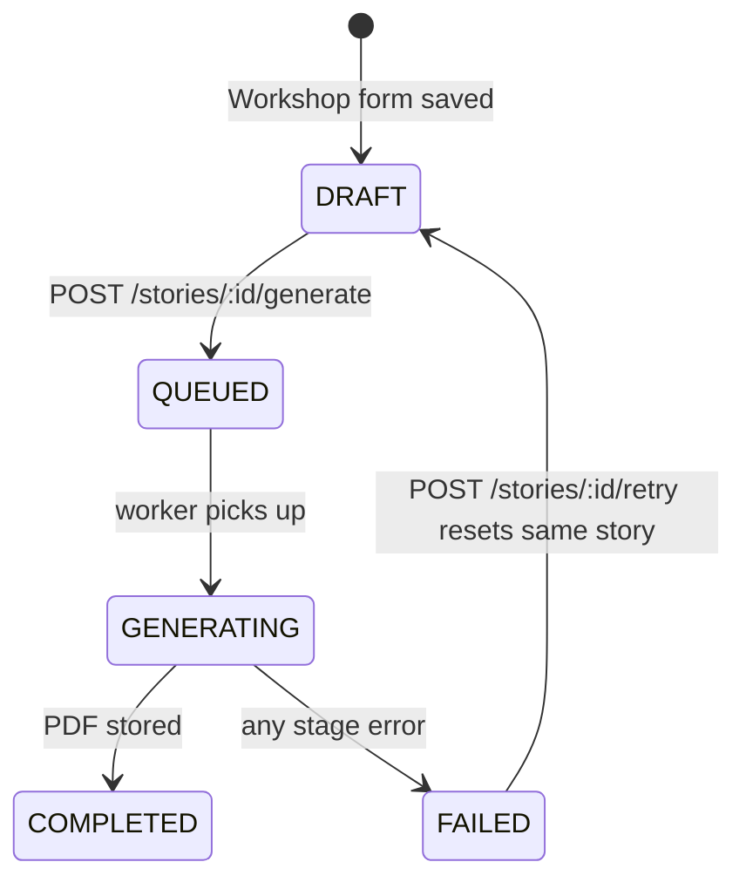

# Data Model

> The Prisma schema as it exists today.
> Source of truth: [`backend/prisma/schema.prisma`](../../backend/prisma/schema.prisma).
> Models are PascalCase, fields camelCase, enum values `SCREAMING_SNAKE_CASE`.

## Entity relationships

```mermaid
erDiagram
    User ||--o{ Child : owns
    User ||--o{ Story : owns
    User ||--o{ StoryBlueprint : "created by"
    User ||--o{ Notification : receives
    User ||--o{ Character : owns
    User ||--|| Subscription : has
    User ||--o{ Rating : writes
    Child ||--o{ Story : "is reader of"
    Child ||--o{ Character : "owns"
    ArtStyle ||--o{ Story : styles
    StoryBlueprint |o--o{ Story : "guided (nullable)"
    Character |o--o{ Story : "snapshot source"
    PricingTier ||--o{ Subscription : defines
    Story ||--o{ Page : "has ordered"
    Story ||--o{ Job : tracks
    Story ||--o{ Rating : receives

    User {
        string id PK
        string email UK
        string googleId UK
        string name
        string avatarUrl "nullable"
        Role role
        json notificationPreferences "nullable"
    }
    Child {
        string id PK
        string userId FK
        string name
        datetime birthdate
        Gender gender
        string interests "string array"
        string avatarUrl "nullable, post-MVP"
    }
    Character {
        string id PK
        string userId FK
        string childId FK
        string name
        string description
        CharacterSource source
        string previewKey "S3 key, nullable"
    }
    ArtStyle {
        string id PK
        string name
        string slug UK
        string thumbnailUrl "S3 signed URL"
        string promptPrefix
        boolean isActive
        int order
    }
    Story {
        string id PK
        string userId FK
        string childId FK
        string artStyleId FK
        string blueprintId FK "nullable"
        string characterId FK "nullable, user-selected protagonist"
        StoryType type
        StoryStatus status
        string question
        int pageCount
        Language language
        StoryGenre genre "nullable, optional flavour knob"
        WritingStyle writingStyle "nullable, optional flavour knob"
        string title "LLM-generated, nullable"
        string styleAnchor "visual-identity snapshot, nullable"
        boolean isPublic "default false"
        string coverImageKey "S3 key, nullable"
        string pdfKey "S3 key, nullable"
    }
    Page {
        string id PK
        string storyId FK
        int order "unique per story"
        string layout "PageTemplate name, nullable"
        string chapterTitle "nullable"
        string text "nullable"
        json illustrations "[{ key, position }]"
        string illustrationPrompt "nullable"
    }
    StoryBlueprint {
        string id PK
        string createdById FK
        string name
        string description
        StoryType type
        string systemPrompt "XML-marked narrative DNA"
        string coverImageKey "S3 key, nullable"
        string previewPageKeys "string array"
    }
    PricingTier {
        string id PK
        string name UK
        string paddleProductId "nullable"
        string paddlePriceId "nullable"
        int priceMonthly "euro cents; 0 = free"
        int pagesPerMonth
        int regenerationsPerMonth
        int characterGenerationsPerMonth
        int childrenLimit "nullable = unlimited"
        int charactersLimit "nullable = unlimited"
        int retentionDays "nullable = forever"
        boolean watermark
        int order
    }
    Subscription {
        string id PK
        string userId FK UK "one per user"
        string pricingTierId FK
        string paddleSubscriptionId "nullable"
        string paddleCustomerId "nullable, kept after cancel"
        SubscriptionStatus status
        boolean cancelAtPeriodEnd
        datetime currentPeriodEnd "nullable"
        int pagesUsed "default 0"
        int regenerationsUsed "default 0"
        int characterGenerationsUsed "default 0"
    }
    Job {
        string id PK
        string storyId FK
        JobType type
        JobStatus status
        string stage "nullable"
        string error "nullable"
        int attempts
    }
    Notification {
        string id PK
        string userId FK
        NotificationType type
        json payload
        datetime readAt "nullable = unread"
    }
    Rating {
        string id PK
        string storyId FK
        string userId FK
        int score "1–5"
        string comment "nullable"
        datetime createdAt
        datetime updatedAt
    }
```

## Entities

| Entity             | What it is                                                                                                                                                                                                                                                                                                                                                                                                                                                                                                                                                                                                                                                                                                                                                                                                                                                                                                                                                                                                                                                                                                    |
| ------------------ | ------------------------------------------------------------------------------------------------------------------------------------------------------------------------------------------------------------------------------------------------------------------------------------------------------------------------------------------------------------------------------------------------------------------------------------------------------------------------------------------------------------------------------------------------------------------------------------------------------------------------------------------------------------------------------------------------------------------------------------------------------------------------------------------------------------------------------------------------------------------------------------------------------------------------------------------------------------------------------------------------------------------------------------------------------------------------------------------------------------- |
| **User**           | Google-OAuth identity. `role` is `USER`, `ADMIN`, or `SUPER_ADMIN`. `notificationPreferences` is a JSON column (null = all defaults on); preferences are merged with defaults in code. Owns children, stories, blueprints, characters, notifications, ratings, and exactly one subscription row.                                                                                                                                                                                                                                                                                                                                                                                                                                                                                                                                                                                                                                                                                                                                                                                                              |
| **Child**          | A reader profile under a User — the story's **subject** (who it is _for_; `name` + age drive the prose, and it is the unit the subscription `childrenLimit` prices). `interests` feeds the generation prompt as an **optional hint** (the model weaves them in only when they fit — never forced). `avatarUrl` is reserved for a post-MVP photo seam — character likeness is stored on `Character`, not `Child`.                                                                                                                                                                                                                                                                                                                                                                                                                                                                                                                                                                                                                                                                                              |
| **Character**      | A **protagonist that belongs to a Child** (`childId` required — a Child may have several; no standalone characters). `description` is a free-text appearance description. The user **selects** one of the reader's characters when creating a story (`Story.characterId`); when present it is the story's hero (name + description drive both prose and illustrations), else the story currently runs **without a fixed recurring hero**. `previewKey` is an S3 key for an AI-generated portrait. When a preview exists, Planning/Pictures can also pass that portrait as a reference image to the image model for stronger cross-page consistency. The Character's description is incorporated into `Story.styleAnchor` at Planning — a snapshot that stays stable even if the Character is later edited. `source` (default `IMAGINED`) records how it was made: `IMAGINED` (free-form — the parent's manual description **or** AI-from-a-prompt; can describe the child in words or an invented creature) · `QUIZ` (the guided human-appearance quiz). `PHOTO` is reserved for the GDPR-blocked photo flow. |
| **ArtStyle**       | Admin-managed visual style. `promptPrefix` is prepended to every image prompt for a story using this style. `isActive` and `order` control what appears in the Workshop grid. `thumbnailUrl` holds a signed S3 URL to a generated sample image.                                                                                                                                                                                                                                                                                                                                                                                                                                                                                                                                                                                                                                                                                                                                                                                                                                                               |
| **Story**          | A book or comic (`type`), owned by a User, for a Child. Carries both the user inputs (`question`, `pageCount`, `language`, etc.) and the generation outputs (`title`, `styleAnchor`, `coverImageKey`, `pdfKey`). `styleAnchor` is generated once during Planning and prepended to every image prompt — it is an immutable per-story snapshot. `characterId` is the user's chosen protagonist (set at creation, validated as owned); Planning loads it to compose `styleAnchor` and never overwrites it. `genre` and `writingStyle` are optional flavour knobs picked in the workshop — each maps to a prompt fragment injected at Planning (omitted when unset). `isPublic` is set via the rating opt-in flow; public stories appear on the landing page.                                                                                                                                                                                                                                                                                                                                                     |
| **Page**           | One ordered page of a Story — **the materialized, validated Story Plan** and the source the PDF renders from. `layout` is a [PageTemplate](generation-pipeline.md#the-pagetemplate-contract) name. `illustrations` holds `{ key, position }` pairs where `position` is the template zone name (e.g. `"main"`, `"cover"`). `illustrationPrompt` is the prompt used to generate the illustration, stored for regeneration provenance. Unique on `(storyId, order)`.                                                                                                                                                                                                                                                                                                                                                                                                                                                                                                                                                                                                                                             |
| **StoryBlueprint** | Admin-authored "narrative DNA". `systemPrompt` carries XML-marked instructions (e.g. `<intro_prompt>`, `<climax_prompt>`) auto-selected by story `type` during Planning. User-facing blueprint selection is post-MVP.                                                                                                                                                                                                                                                                                                                                                                                                                                                                                                                                                                                                                                                                                                                                                                                                                                                                                         |
| **PricingTier**    | A subscription tier definition. `priceMonthly` is in euro cents (0 = free). `pagesPerMonth`, `regenerationsPerMonth`, and `characterGenerationsPerMonth` are the monthly quotas. `childrenLimit` and `charactersLimit` are null for unlimited. `retentionDays` is null for indefinite retention. `watermark` controls whether generated PDFs carry a watermark overlay. The free tier has no Paddle product (`paddleProductId`/`paddlePriceId` are null). Named `PricingTier` — not `Plan` — to avoid collision with Story Plan.                                                                                                                                                                                                                                                                                                                                                                                                                                                                                                                                                                              |
| **Subscription**   | Every user owns exactly one Subscription row (lazy-created on first use, defaulting to the free tier). `paddleCustomerId` is kept after cancellation so invoice history stays reachable in the Paddle portal. `cancelAtPeriodEnd` is set by a scheduled cancellation; the paid tier stays active until Paddle emits `subscription.canceled`. Counters (`pagesUsed`, `regenerationsUsed`, `characterGenerationsUsed`) reset at the start of each billing cycle via the Paddle `subscription.updated` webhook.                                                                                                                                                                                                                                                                                                                                                                                                                                                                                                                                                                                                  |
| **Job**            | Tracks one BullMQ generation or regeneration run. `stage` drives the SSE progress UI. A Story accumulates `Job[]` over time as pages are regenerated.                                                                                                                                                                                                                                                                                                                                                                                                                                                                                                                                                                                                                                                                                                                                                                                                                                                                                                                                                         |
| **Notification**   | In-app bell record per User. `payload` is event-shaped JSON. `readAt = null` means unread. Email is sent alongside the record by `NotificationEmitterService` based on the user's `notificationPreferences`.                                                                                                                                                                                                                                                                                                                                                                                                                                                                                                                                                                                                                                                                                                                                                                                                                                                                                                  |
| **Rating**         | A story rating by its owner (one per user per story — unique on `[storyId, userId]`). Submitting a rating with `isPublic: true` sets `Story.isPublic = true`; `isPublic: false` retracts it.                                                                                                                                                                                                                                                                                                                                                                                                                                                                                                                                                                                                                                                                                                                                                                                                                                                                                                                  |

### `Story.styleAnchor`

A Planning-generated string describing recurring characters and overall visual style, prepended to every illustration prompt to maintain cross-page art consistency. Generated once from the selected Character (if any) + the ArtStyle's `promptPrefix` + story context. Null until Planning completes. Because it is a snapshot, editing a Character after story creation does not affect existing stories.

## Cascade deletes and S3

| Relation                   | `onDelete`   | Effect                                                                                              |
| -------------------------- | ------------ | --------------------------------------------------------------------------------------------------- |
| `Child.user`               | `Cascade`    | Deleting a User deletes their Children.                                                             |
| `Story.user`               | `Cascade`    | Deleting a User deletes their Stories (cascades to Pages + Jobs).                                   |
| `Story.child`              | `Cascade`    | Deleting a Child deletes their Stories (cascades to Pages + Jobs).                                  |
| `Character.user`           | `Cascade`    | Deleting a User deletes their Characters.                                                           |
| `Character.child`          | `Cascade`    | Deleting a Child deletes its Characters (every Character belongs to a Child).                       |
| `Story.character`          | `SetNull`    | Deleting a Character clears `Story.characterId` — the story's `styleAnchor` snapshot is unaffected. |
| `Story.blueprint`          | `SetNull`    | Deleting a StoryBlueprint sets `Story.blueprintId = null` — stories survive.                        |
| `Page.story`               | `Cascade`    | Deleting a Story deletes its Pages.                                                                 |
| `Job.story`                | `Cascade`    | Deleting a Story deletes its Jobs.                                                                  |
| `Notification.user`        | `Cascade`    | Deleting a User deletes their Notifications.                                                        |
| `Rating.story`             | `Cascade`    | Deleting a Story deletes its Ratings.                                                               |
| `Rating.user`              | `Cascade`    | Deleting a User deletes their Ratings.                                                              |
| `Subscription.user`        | `Cascade`    | Deleting a User deletes their Subscription row.                                                     |
| `Story.artStyle`           | _(Restrict)_ | Deleting an ArtStyle is blocked while Stories reference it.                                         |
| `StoryBlueprint.createdBy` | _(Restrict)_ | Deleting a User is blocked while they own Blueprints.                                               |
| `Subscription.pricingTier` | _(Restrict)_ | Deleting a PricingTier is blocked while Subscriptions reference it.                                 |

**S3 and account deletion:** `DELETE /me` deletes all of the user's S3 objects by prefix listing before cascading the DB delete. This covers PDFs, page illustrations, cover images, and character preview images. Deleting an individual Story (via the admin panel or `DELETE /stories/:id`) now deletes the story's own assets first, then removes the DB row. The retention cleanup cron (`0 4 * * *`) still handles PDFs and illustrations that have passed their tier's `retentionDays`.

## Enums and status lifecycles

```
Role              USER · ADMIN · SUPER_ADMIN
Gender            MALE · FEMALE
Language          EN · DE · RU
CharacterSource   IMAGINED · QUIZ · PHOTO   (PHOTO reserved — GDPR-blocked)
StoryType         BOOK · COMIC           (COMIC modelled; generation is post-MVP)
StoryGenre        FAIRY_TALE · BEDTIME · EDUCATIONAL · ADVENTURE   (optional, prompt fragment)
WritingStyle      POETIC · SIMPLE · IMAGINATIVE                    (optional, prompt fragment)
StoryStatus       DRAFT · QUEUED · GENERATING · COMPLETED · FAILED
JobType           GENERATION · REGENERATION
JobStatus         PENDING · ACTIVE · COMPLETED · FAILED
SubscriptionStatus  ACTIVE · PAST_DUE · CANCELED
NotificationType  STORY_COMPLETED · STORY_FAILED · PAYMENT_FAILED · SUBSCRIPTION_CANCELED
```

**Story status** is driven entirely by the generation pipeline:



A FAILED story can be retried in place: the workshop form accepts a `?storyId=` param, pre-fills all fields from the failed story, and `POST /stories/:id/retry` deletes the failed story's generated assets + pages, then resets that same row back to `DRAFT`.

`Job.status` tracks the BullMQ job in parallel: `PENDING` (enqueued) → `ACTIVE` (worker processing) → `COMPLETED` / `FAILED`. The "one active generation per user" rule checks for `PENDING` or `ACTIVE` jobs across all of a user's stories.

**Subscription status** is driven exclusively by Paddle webhooks:

```
ACTIVE    — billing current; full tier quota available
PAST_DUE  — payment failed; Paddle is retrying (dunning); access is preserved during retry window
CANCELED  — subscription ended; user reverted to free tier
```

## Migrations

Migrations live in [`backend/prisma/migrations/`](../../backend/prisma/migrations).

Apply with `pnpm --filter ./backend db:migrate` (dev) or `db:migrate:deploy` (CI/prod).
See [getting-started.md](../guides/getting-started.md).
