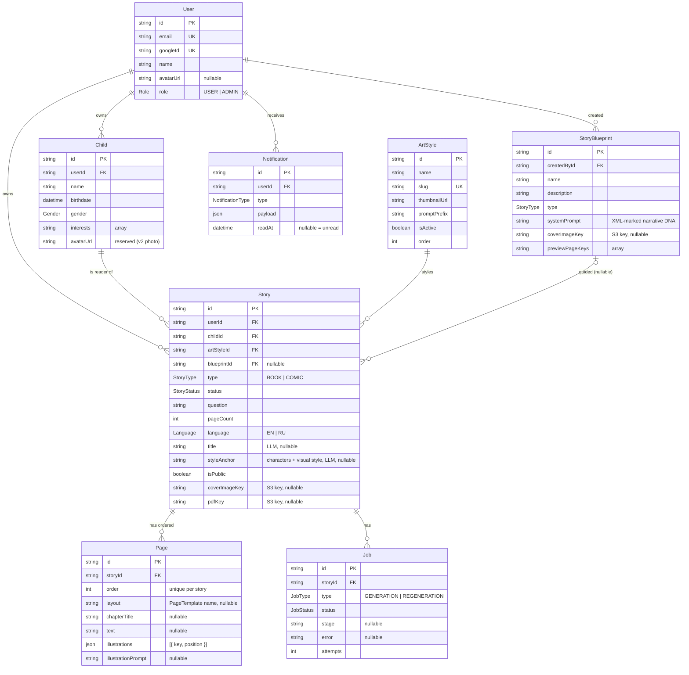
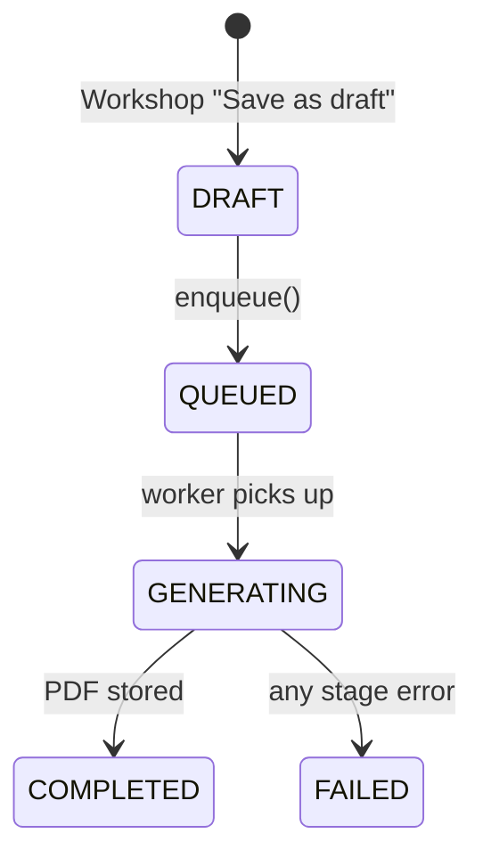

# Data Model

> The Prisma schema as it exists today.
> Source of truth: [`backend/prisma/schema.prisma`](../../backend/prisma/schema.prisma).
> Models are PascalCase, fields camelCase, enum values `SCREAMING_SNAKE_CASE`.

## Entity relationships



## Entities

| Entity             | What it is                                                                                                                                                                                                                                                                                                                                                                                                                                                                                                                                                                                                             |
| ------------------ | ---------------------------------------------------------------------------------------------------------------------------------------------------------------------------------------------------------------------------------------------------------------------------------------------------------------------------------------------------------------------------------------------------------------------------------------------------------------------------------------------------------------------------------------------------------------------------------------------------------------------- |
| **User**           | Google-OAuth identity. `role` is `USER` or `ADMIN`. `avatarUrl` stores the Google profile picture (nullable). Owns children, stories, blueprints, notifications.                                                                                                                                                                                                                                                                                                                                                                                                                                                       |
| **Child**          | A reader profile under a User. `interests` feeds personalization; `avatarUrl` is reserved for the v2 photo seam.                                                                                                                                                                                                                                                                                                                                                                                                                                                                                                       |
| **ArtStyle**       | Admin-managed visual style. `name` is the display label; `thumbnailUrl` is the preview shown in the Workshop grid; `promptPrefix` is prepended to every image prompt; `isActive` + `order` control visibility and ordering.                                                                                                                                                                                                                                                                                                                                                                                            |
| **Story**          | A book or comic (`type`), owned by a User, for a Child. Carries the user inputs and the generation outputs (`title`, `styleAnchor`, `coverImageKey`, `pdfKey`). Books and comics share one entity — they differ only by `type`. `styleAnchor` (Planning-generated) is described below. `isPublic` defaults to `false` and has **no setter endpoint** at MVP — it is intended to be set via the rating/opt-in flow (Post-MVP). The only effect today is that `GET /stories/public` returns rows where `isPublic = true`; since nothing sets it, that endpoint always returns an empty list until the rating flow ships. |
| **Page**           | One ordered page of a Story — **the materialized, validated Story Plan** and the source the PDF renders from. `layout` is a [PageTemplate](generation-pipeline.md#the-pagetemplate-contract) name (nullable before Planning). `illustrations` holds `{ key, position }` pairs where `position` is the template zone name (e.g. `"main"`, `"cover"`). Unique on `(storyId, order)`.                                                                                                                                                                                                                                     |
| **StoryBlueprint** | Admin-authored "narrative DNA". `name` and `description` identify it for admins. `systemPrompt` carries XML-marked instructions auto-selected by story `type` during Planning. `coverImageKey` and `previewPageKeys` are optional S3 references for blueprint preview images. (User-facing selection is Post-MVP.)                                                                                                                                                                                                                                                                                                     |
| **Job**            | Tracks one BullMQ generation (or, when added, regeneration) run. `stage` drives the SSE progress UI. A Story has `Job[]` because regeneration adds more rows over time.                                                                                                                                                                                                                                                                                                                                                                                                                                                |
| **Notification**   | In-app bell record per User. `payload` is event-shaped JSON; `readAt = null` means unread. Email is sent alongside the row by `NotificationsService`.                                                                                                                                                                                                                                                                                                                                                                                                                                                                  |

> **`Story.styleAnchor`** — a Planning-generated string describing recurring characters and
> overall visual style, prepended to every illustration prompt to keep cross-page art consistent.
> Null until Planning completes.

### Cascade deletes and S3 orphaning

The actual `onDelete` values in `schema.prisma` (Prisma's default when omitted is Restrict):

| Relation                   | `onDelete`   | Effect                                                                       |
| -------------------------- | ------------ | ---------------------------------------------------------------------------- |
| `Child.user`               | `Cascade`    | Deleting a User deletes their Children.                                      |
| `Story.user`               | `Cascade`    | Deleting a User deletes their Stories (and cascades to Pages + Jobs).        |
| `Story.child`              | `Cascade`    | Deleting a Child deletes their Stories (and cascades to Pages + Jobs).       |
| `Story.blueprint`          | `SetNull`    | Deleting a StoryBlueprint sets `Story.blueprintId = null` — stories survive. |
| `Page.story`               | `Cascade`    | Deleting a Story deletes its Pages.                                          |
| `Job.story`                | `Cascade`    | Deleting a Story deletes its Jobs.                                           |
| `Notification.user`        | `Cascade`    | Deleting a User deletes their Notifications.                                 |
| `Story.artStyle`           | _(Restrict)_ | Deleting an ArtStyle is blocked while Stories reference it.                  |
| `StoryBlueprint.createdBy` | _(Restrict)_ | Deleting a User is blocked while they own Blueprints.                        |

**S3 is not part of the cascade.** Deleting a `Story` removes its DB rows, but any S3 objects
(`coverImageKey`, `pdfKey`, `Page.illustrations[].key`) are **not deleted** — they become
orphaned objects in the bucket. The same applies to `User` and `Child` deletions. A placeholder
comment exists in `StoriesService.remove()` (Phase 5 deferral). Cleanup is planned — see ROADMAP.

### Not yet in the schema

The ROADMAP describes **`PricingTier`**, **`Subscription`**, and **`Rating`**. These are
**not in `schema.prisma` yet** — they land with the subscriptions and ratings work. Treat the
glossary entries in [`ROADMAP.md` §4](../../ROADMAP.md) as the plan, not the current schema.

## Enums & status lifecycles

```
Role          USER · ADMIN
Gender        MALE · FEMALE
Language      EN · RU
StoryType     BOOK · COMIC          (COMIC modelled but generation deferred)
StoryStatus   DRAFT · QUEUED · GENERATING · COMPLETED · FAILED
JobType       GENERATION · REGENERATION
JobStatus     PENDING · ACTIVE · COMPLETED · FAILED
NotificationType  STORY_COMPLETED · STORY_FAILED
```

All enum values are `SCREAMING_SNAKE_CASE` (see the Prisma rules).

**Story status** is driven by the generation pipeline:



Today a FAILED story is terminal — `enqueue()` only accepts a story in `DRAFT`. A "Try again"
path that re-opens generation from FAILED is planned (see ROADMAP).

`Job.status` runs in parallel: `PENDING` (enqueued; set by `GenerationService`) →
`ACTIVE` (worker has picked up the job; set by BullMQ when processing begins) →
`COMPLETED`/`FAILED`. The "one active generation per user" rule keys off `PENDING`/`ACTIVE` jobs.

## Migrations

Migrations live in [`backend/prisma/migrations/`](../../backend/prisma/migrations).

Apply with `pnpm --filter ./backend db:migrate` (dev) or `db:migrate:deploy` (CI/prod). See [getting-started.md](../guides/getting-started.md).
