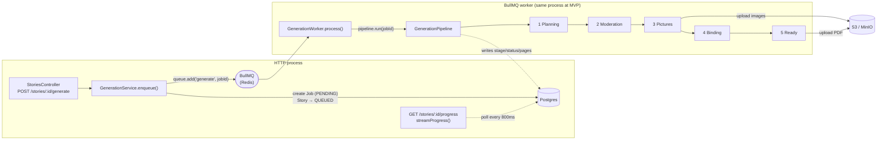
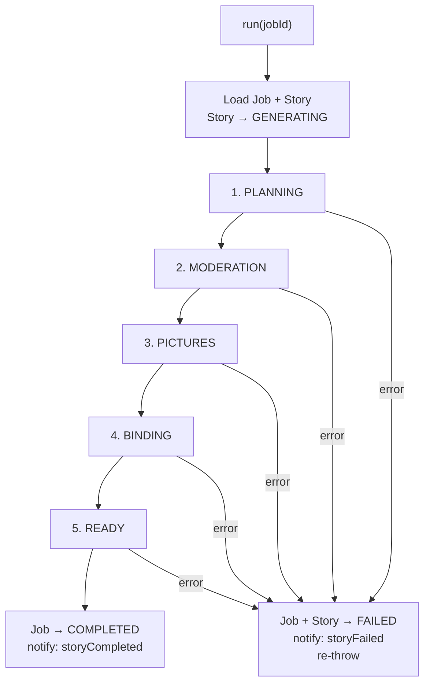

# Generation Pipeline

> How a DRAFT story becomes a downloadable, illustrated A5 PDF.
> Code: [`backend/src/modules/generation/`](../../backend/src/modules/generation),
> [`rendering/`](../../backend/src/modules/rendering), [`ai/`](../../backend/src/modules/ai).

## The shape in one picture



Three classes, one queue. The HTTP side only **enqueues** and **reads progress**; all the
heavy work happens in the worker, decoupled by Redis.

## Three classes, deliberately separate

[`GenerationModule`](../../backend/src/modules/generation/generation.module.ts) provides
three classes with sharply different jobs. Keeping them apart is what makes the pipeline
testable without Redis.

| Class                | Runs in          | Knows about BullMQ?      | Job                                                                                        |
| -------------------- | ---------------- | ------------------------ | ------------------------------------------------------------------------------------------ |
| `GenerationService`  | HTTP request     | **Yes** (`@InjectQueue`) | Validate, enforce 1-per-user, create the `Job` row, enqueue, stream progress               |
| `GenerationWorker`   | BullMQ worker    | **Yes** (`@Processor`)   | Pull `jobId` off the BullMQ payload, call `pipeline.run(jobId)`. No business logic.        |
| `GenerationPipeline` | called by Worker | **No**                   | The actual 5-stage generation. A plain `@Injectable()` with one entry point: `run(jobId)`. |

`GenerationPipeline` has zero BullMQ imports, so tests call `pipeline.run(jobId)` directly with the stub AI client and never start Redis — see [`generation.pipeline.spec.ts`](../../backend/src/modules/generation/__tests__/generation.pipeline.spec.ts). BullMQ is an edge concern; the pipeline is pure domain logic.

### Dependency injection

`GenerationModule` imports `AiModule`, `RenderingModule`, `StorageModule`, and `NotificationsModule`; all inject their services into `GenerationPipeline`. `AI_CLIENT` is a Symbol token — see [AiClient vs AiStubClient](#aiclient-vs-aistubclient-the-symbol-token-swap).

## The five stages

`GenerationPipeline.run(jobId)` loads the `Job` and its `Story` (with `child` + `artStyle`),
flips the story to `GENERATING`, then runs the stages in order. Each stage first writes its
name to `Job.stage` (which the SSE stream reads). Any thrown error is caught once at the
top: the `Job` and `Story` both go `FAILED`, a failure notification fires, and the error
re-throws so BullMQ records the failure.



### 1. Planning — _the only text-generation call_

Picks the `StoryBlueprint` for the story's `type` (first by `createdAt`), loads the chosen
protagonist (`Story.characterId`, if any), builds the system and user prompts via
[`StoryPromptBuilder`](../../backend/src/modules/generation/story-prompt-builder.ts),
computes a `max_tokens` ceiling, and asks the LLM for a **Story Plan** — a JSON object with
this shape:

The user prompt composes: the child's name + age (audience targeting) · the chosen Character
as the protagonist when present (else child-led) · the child's `interests` as an **optional,
non-forcing hint** (woven in only when they fit) · the optional `genre` and `writingStyle`
flavour knobs, each injecting a fixed prompt fragment when set (omitted otherwise) · the
ArtStyle's `promptPrefix`.

```json
{
    "title": "...",
    "styleAnchor": "...",
    "pages": [
        {
            "template": "...",
            "text": "...",
            "chapterTitle": "...",
            "illustration": { "prompt": "..." }
        }
    ]
}
```

The plan is validated (see [validation](#storyplanvalidator-two-class-failures)); on
structural failure it's repaired once. Then it's **persisted**:

- `Story.title`, `Story.styleAnchor`, `Story.blueprintId` are updated.
- One `Page` row is created per plan page, with `layout` (= template name), `text`,
  `chapterTitle`, **`illustrationPrompt`**, and `illustrations: []` (empty for now).

> `illustrationPrompt` is stored during Planning because the prompt is a planning output. The Pictures stage reads it directly from the DB row — no in-memory plan array to keep in sync — and page-regeneration reuses it as provenance.

The `max_tokens` ceiling ([`computeMaxTokens`](../../backend/src/modules/generation/generation.constants.ts))
is a runaway-spend guard derived from page count and a per-language chars/token estimate
(EN ≈ 4, RU ≈ 2), capped at 8000.

### 2. Moderation — _silent, before we spend on images_

Concatenates all page text and runs `ai.moderateText()`. Unsafe → the stage throws and the
story fails with the moderation reason. This runs **after Planning but before Pictures** on
purpose: image generation is the expensive step, so we reject unsafe text before paying for
pictures. Image safety relies on the provider's own flags today (a dedicated image
moderation provider is post-MVP).

### 3. Pictures — _parallel, capped, writes the cover_

Loads the persisted `Page` rows, keeps only those whose template has image zones, and
generates illustrations with **capped concurrency** (`IMAGE_CONCURRENCY = 3`): the pages are
sliced into batches of 3 and each batch is awaited with `Promise.all`. Text was a single
structured call, so only images parallelize.

For each page: the prompt is `styleAnchor + "\n\n" + page.illustrationPrompt + "\n\n" +
IMAGE_NO_TEXT_DIRECTIVE` (the style anchor is prepended to **every** image for cross-page
character/style consistency; when the selected Character already has a generated preview,
that preview is also passed as a **reference image** to the image model for stronger visual
identity carry-over; the no-text directive forbids in-image words on every image — including
covers and COMIC speech bubbles — since image models render text, especially Cyrillic,
unreliably),
the image size comes from the template's `images[0].size`, the bytes are uploaded to
`StorageKeys.pageIllustration(userId, storyId, order)`, and the key is written back to
`Page.illustrations` as `[{ key, position }]`.

> `coverImageKey` is set here because the cover is page 1's illustration — already known by the end of Pictures. Ready is only about the finished PDF.

Each completed image becomes a **per-page SSE event** (see [progress](#real-time-progress-sse)) —
that's what lights up the thumbnails on the workshop page one by one.

### 4. Binding — _HTML → PDF_

For each page, fetches its illustration from S3 and embeds it as a base64 data URL before
handing a flat `IPageToRender[]` to [`PdfRendererService.render()`](../../backend/src/modules/rendering/pdf-renderer.service.ts).

> Base64 embedding is necessary because Puppeteer runs server-side inside Node.js and cannot
> follow private S3 pre-signed URLs from within the headless browser context.
> The renderer resolves each page's Handlebars template by `layout`, injects the data, prints
> each page to an A5 PDF with Puppeteer (waiting on `document.fonts.ready` for deterministic
> output), and stitches them with pdf-lib. **Watermark** is applied when `PricingTier.watermark
= true` (free tier) — `QuotaService.shouldWatermark(userId)` is called before binding and the
> flag is passed into `PdfBindingService`.

### 5. Ready — _publish_

Uploads the PDF to `StorageKeys.storyPdf(userId, storyId)`, sets `Story.pdfKey` and
`Story.status = COMPLETED`. The pipeline then marks `Job` COMPLETED and fires the `storyCompleted` notification. The
`Notification` row is written first; the email is sent in a `try/catch` — failures are
logged (`logger.error`) but not re-thrown, so a failed email never rolls back the generation.

### What each stage writes — quick reference

| Stage      | `Job.stage`  | Writes to Postgres                                                                  | Writes to S3       |
| ---------- | ------------ | ----------------------------------------------------------------------------------- | ------------------ |
| Planning   | `planning`   | `Story.title/styleAnchor/blueprintId`, all `Page` rows (incl. `illustrationPrompt`) | —                  |
| Moderation | `moderation` | — (throws on unsafe)                                                                | —                  |
| Pictures   | `pictures`   | `Page.illustrations[]`, `Story.coverImageKey`                                       | page illustrations |
| Binding    | `binding`    | —                                                                                   | —                  |
| Ready      | `ready`      | `Story.pdfKey`, `Story.status = COMPLETED`                                          | the stitched PDF   |

## The PageTemplate contract

[`page-templates.config.ts`](../../backend/src/modules/rendering/page-templates.config.ts) is
the **single source of truth shared by the prompt builder, the validator, and the
renderer.** Each entry declares `htmlFile`, `type` (BOOK/COMIC), `role`
(cover/interior/final), a `narrativePurpose` (tells the LLM _when_ to pick it), `maxChars`
per text zone, and `images` (`{ name, aspect, size }` with concrete pixel dimensions).

The division of labor: **the LLM is a dramaturge, not a typesetter.** It picks a template
name and writes text + an illustration prompt. It never emits image sizes (looked up from
the template) or character counts (measured by us). Code fixes the invariants (page 1 =
cover, last = final, count = requested); the validator enforces them.

## StoryPlanValidator: two-class failures

[`StoryPlanValidator.validate()`](../../backend/src/modules/generation/story-plan.validator.ts)
returns **two separate lists**, treated completely differently:

| Class                 | Examples                                                                                                                                                                         | Handling                                                                                                                      |
| --------------------- | -------------------------------------------------------------------------------------------------------------------------------------------------------------------------------- | ----------------------------------------------------------------------------------------------------------------------------- |
| **Structural errors** | wrong page count; page 1 not a cover; last page not final; unknown template; template type ≠ story type; interior page using a cover/final template; missing illustration prompt | **One repair retry** — the errors are appended to the prompt and the LLM tries again. Still broken → the story **FAILS**.     |
| **Soft warnings**     | `page.text` longer than the template zone's `maxChars`; prose that does not end with a complete sentence                                                                         | **Logged, never blocks.** CSS handles overflow; sentence warnings are kept as usable prose instead of failing the whole plan. |

> **Why not truncate overflowing text?** Truncating mid-narrative on a children's story
> page can drop the punchline or the emotional payoff. Clipping a few characters visually is
> recoverable; silently corrupting the story is not. So overflow is a warning, not an error,
> and the CSS auto-fit safety net handles the rare overrun.

Structural errors are about a plan we _cannot render_; soft warnings are about a plan that
_renders imperfectly but remains usable_. Only the first is worth a retry or a failure.

## AiClient vs AiStubClient: the Symbol-token swap

[`IAiClient`](../../backend/src/modules/ai/ai.types.ts) has two implementations:

- [`AiClient`](../../backend/src/modules/ai/ai.client.ts) — real OpenRouter over `fetch`.
  Exponential backoff (3 retries), 4xx fails immediately, 5xx retries.
- [`AiStubClient`](../../backend/src/modules/ai/ai-stub.client.ts) — deterministic canned
  story plan + a placeholder PNG, no network.

`IAiClient` is a **TypeScript interface — it disappears at runtime**, so it can't be a DI
token. Instead [`AiModule`](../../backend/src/modules/ai/ai.module.ts) registers a `Symbol`,
`AI_CLIENT`, with a factory that returns the stub or the real client based on
`USE_AI_STUBS`:

```ts
{
  provide: AI_CLIENT,
  inject: [ConfigService, AiClient, AiStubClient],
  useFactory: (config, real, stub) =>
    config.get<boolean>('USE_AI_STUBS') ? stub : real,
}
```

Consumers inject `@Inject(AI_CLIENT) ai: IAiClient` and never know which one they got. The
payoff: **the entire pipeline — and CI — runs offline with zero AI spend** by setting
`USE_AI_STUBS=true`. The same pattern backs `EMAIL_CLIENT` (`ResendClient` vs
`EmailStubClient`), gated by `USE_EMAIL_STUBS`.

The LLM is constrained two ways so the JSON shape is guaranteed: OpenRouter's
`response_format: json_schema` (derived from the Zod `storyPlanSchema` via
`z.toJSONSchema()`) physically constrains capable models, and a Zod `safeParse` runs anyway
as defense-in-depth in case a model is swapped for one that ignores JSON Schema.

## Real-time progress (SSE)

`GET /stories/:id/progress` →
[`GenerationService.streamProgress()`](../../backend/src/modules/generation/generation.service.ts)
returns an RxJS `Observable<MessageEvent>`. It checks ownership + reads `pageCount` once at
subscription start, then **polls Postgres every 800 ms** with a single query that returns the
latest job plus a count of pages that already have illustrations. It emits:

| Event           | When                                                                                       |
| --------------- | ------------------------------------------------------------------------------------------ |
| `snapshot`      | first poll, and whenever `Job.stage` changes                                               |
| `page_complete` | once per newly-illustrated page (replays from 0 on first poll) — drives the thumbnail grid |
| `completed`     | `Job.status = COMPLETED`                                                                   |
| `failed`        | `Job.status = FAILED`                                                                      |

> Polling Postgres instead of pushing from the worker because the worker and the HTTP handler share only Postgres. Push would require Redis Pub/Sub — more moving parts for a latency gain invisible on a ~2-minute generation. Redis Pub/Sub is the post-MVP scale-out path.

## Retry semantics for failed stories

Failed-story recovery is intentionally **in-place**, not "clone and try again". The workshop
prefills from the failed story, then `POST /stories/:id/retry`:

1. validates the replacement config,
2. deletes the story's generated assets (`coverImageKey`, `pdfKey`, page illustrations),
3. deletes existing `Page` rows,
4. resets the same `Story` row to `DRAFT` and clears generation outputs.

That keeps a stable `storyId`, avoids duplicate failed shells in the library, and guarantees
the next generation starts from a clean persisted state.

## Scale envelope (MVP)

These are the known constraints, not benchmarks — no load testing has been done:

- **One active generation per user.** Enforced by the API (409 if a `PENDING`/`ACTIVE` job
  exists for the user). A second request is rejected, not queued.
- **One in-process worker.** The BullMQ worker runs in the same process as the API server.
  Concurrent generations across users are bounded by the single worker's capacity.
- **Image concurrency 3.** The Pictures stage batches image generation requests in groups of 3
  (`IMAGE_CONCURRENCY`). This is the primary throttle on external API call rate.
- **Generation time.** With stub clients (`USE_AI_STUBS=true`), the pipeline completes in
  seconds. Real generation time depends on OpenRouter latency and the number of pages;
  expect 1–3 minutes for a 12-page book under normal conditions.
- **Horizontal scale path.** Adding worker processes against the shared Redis queue requires
  no code change — the architecture already decouples HTTP from the worker.

## Retry policy and failure recovery

`GenerationWorker` is registered with **no retry configuration** — it uses the BullMQ default of
1 attempt (i.e., no automatic retry). When the pipeline throws, BullMQ marks the job `failed`,
and `GenerationPipeline`'s own catch block sets both `Job.status = FAILED` and
`Story.status = FAILED`.

**Worker crash mid-run** (process killed, OOM, container restart): if the worker dies between
`Job.status = ACTIVE` and the pipeline's catch block running, the story can be left in
`GENERATING` with no Job transition. There is no automatic recovery — the story requires manual
DB intervention to be usable again (see [runbook.md](../guides/runbook.md#story-stuck-in-generating)).

**Retrying a failed story:** once a story is `FAILED`, the user can open the Workshop with
`?storyId=<failedId>`. The form pre-fills all fields from the failed story and submits a new
`DRAFT` Story on confirm. The old `FAILED` row is left intact.

## Concurrency & failure rules (business invariants)

- **One active generation per user.** `enqueue()` rejects with `409 Conflict` if any
  `Job` with status `PENDING`/`ACTIVE` exists for the user's stories. A story must be
  `DRAFT` to enqueue.
- **Status transitions:** `DRAFT → QUEUED` (enqueue) `→ GENERATING` (worker picks up)
  `→ COMPLETED` or `→ FAILED`.
- **One in-process worker** at MVP; image fan-out is internal (concurrency 3). Horizontal
  scale = add worker processes against the shared Redis queue, no code change.

## Page regeneration

Page regeneration is handled by `RegenerationModule` (separate from the generation pipeline)
and reuses `PdfBindingService` to re-stitch the PDF after every change.

```
POST /stories/:id/pages/:order/regenerate { what, prompt? }
  → QuotaService: assert regenerationsUsed < PricingTier.regenerationsPerMonth
  → load Story (styleAnchor, artStyle) + Page (illustrationPrompt)
  → Subscription.regenerationsUsed++
  → [if text/both] AiClient.generateStoryPlan (single-page variant)
  → [if illustration/both] AiClient.generateImage (styleAnchor + illustrationPrompt + prompt?)
  → StorageModule: upload new illustration
  → DB: update Page
  → PdfBindingService: re-render + re-stitch full PDF
  → StorageModule: upload new PDF (overwrites existing pdfKey key)
  → DB: Story.pdfKey updated
```

`what: 'both'` re-generates text and illustration in one call (1 quota unit). Calling text
then illustration separately costs 2 units. The `RegenerationPanel`'s "Remake everything"
button always uses the atomic `'both'` path.

The in-browser reader uses `GET /stories/:id/pages/:order/html` — the same Handlebars
template path that Puppeteer uses — so the iframe always shows exactly what the PDF looks
like. Fonts are served from `GET /static/fonts/*` with `Access-Control-Allow-Origin: *`
(set on the static file middleware, before the global CORS filter applies).
