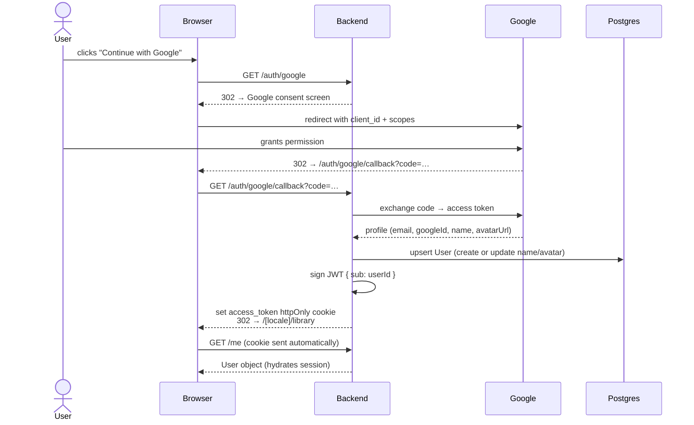
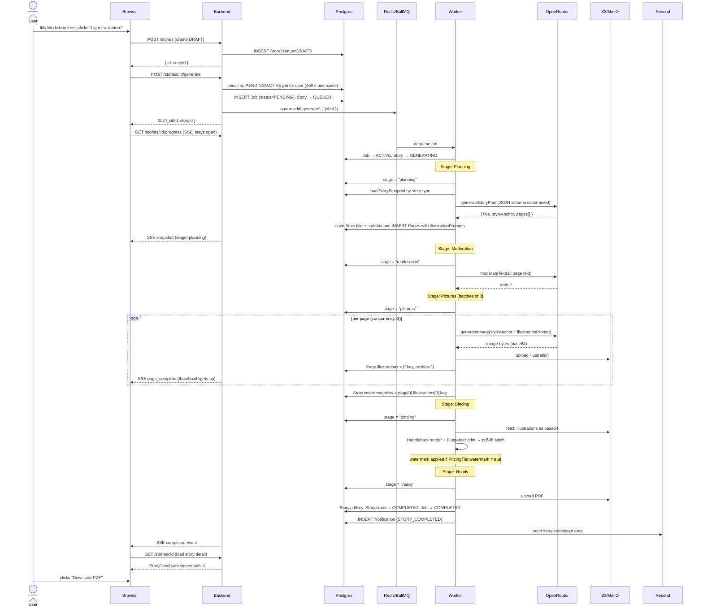
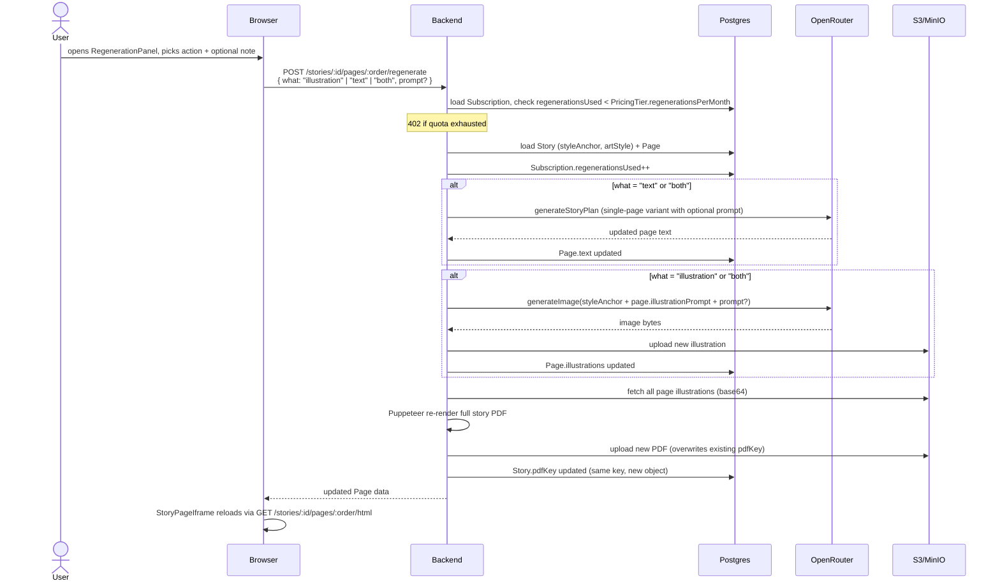
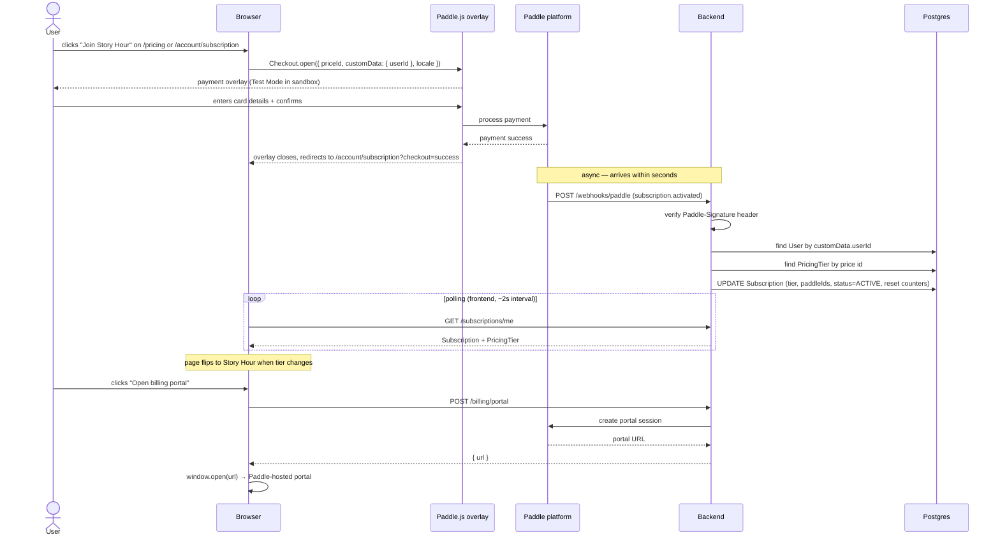
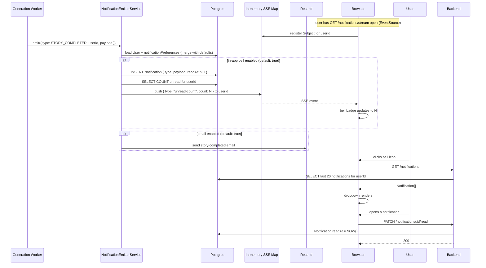

# User Flows

> Sequence diagrams for the key end-to-end flows. Backend base: `http://localhost:3001`.

## 1. Google OAuth sign-in

## 2. Story generation (happy path)

## 3. Page regeneration

## 4. Subscription checkout (Paddle)

## 5. Notification delivery (bell + email)

