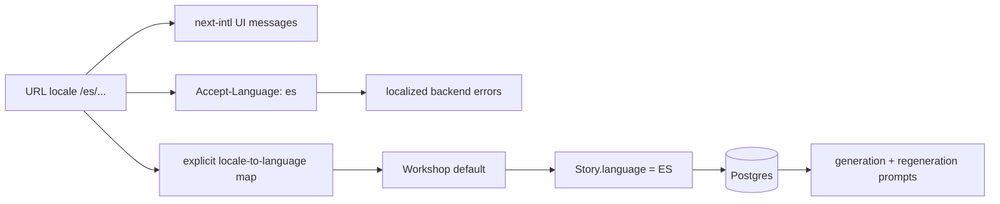

# Discovery: Spanish language support

> Implementation-ready plan for [GitHub issue #88](https://github.com/Shagon1k/TailorTales/issues/88).
> This document describes a future change; the current system still supports only English,
> Russian, and German.

## Decision

Add Spanish as both a UI locale (`es`) and a generated-story language (`ES`) by extending the
existing compile-time registries and translation catalogs. Keep those concepts distinct and map
between them explicitly. Do not add a persisted user locale or a translation-management service
for this release.

Ship the work incrementally, but do not expose `es` in `routing.locales` until the Spanish catalog,
backend errors, story generation path, SEO metadata, and automated checks are ready together. This
keeps every enabled locale complete and prevents partially translated pages from becoming
indexable.

## Current architecture

### Two language concepts



| Concept                          | Current source of truth                                                       | Consumers                                                                         | Persistence                                                                   |
| -------------------------------- | ----------------------------------------------------------------------------- | --------------------------------------------------------------------------------- | ----------------------------------------------------------------------------- |
| UI locale                        | `frontend/src/i18n/config.ts` (`en`, `ru`, `de`)                              | next-intl middleware/request config, locale-aware navigation, page copy           | Locale-prefixed URL and next-intl middleware behavior; no `User.locale` field |
| Story language                   | `backend/prisma/schema.prisma` (`EN`, `RU`, `DE`)                             | story DTO validation, generation, regeneration, API responses, data export        | Required `Story.language` enum column                                         |
| Frontend story-language metadata | `frontend/src/constants/languages.ts` and `frontend/src/types/story.types.ts` | Workshop selector/default, summaries, story cards/details, Paddle locale metadata | Not persisted separately                                                      |
| Backend HTTP error locale        | `backend/src/common/error-translations.ts`                                    | `AllExceptionsFilter`, selected from `Accept-Language`                            | Per request only                                                              |

The frontend API client already sends the active document language as `Accept-Language`
(`frontend/src/lib/api.ts`), so UI locale and backend error locale normally agree. The Workshop
uses `LOCALE_TO_LANGUAGE` to preselect the current UI locale as the story language, but the user
can choose a different story language (`frontend/src/app/[locale]/(private)/workshop/_components/WorkshopForm/WorkshopForm.tsx`).

### Frontend localization

- `frontend/src/middleware.ts` applies next-intl routing to application paths.
- `frontend/src/i18n/request.ts` validates the requested locale against the routing registry and
  dynamically imports `frontend/src/i18n/locales/<locale>.json`.
- `frontend/src/i18n/navigation.ts` supplies locale-aware `Link`, router, and pathname wrappers.
- `frontend/src/i18n/locales/en.json`, `de.json`, and `ru.json` contain approximately 1,400 lines
  each. English is the appropriate source catalog for Spanish translation.
- `frontend/src/components/shared/Header/components/LocaleSwitcher/LocaleSwitcher.tsx` derives
  its choices from the configured locale model, while the account language page is still only a
  placeholder (`frontend/src/app/[locale]/(private)/account/language/page.tsx`).
- `frontend/src/constants/languages.ts` separately defines native story-language names, BCP-47
  codes, ordering, and the UI-locale-to-story-language map.

The catalogs are committed JSON files loaded at build/request time. There is currently no
translation service, fallback catalog merge, or automated cross-catalog key-parity test. A missing
Spanish key could therefore fail at render time or remain undiscovered until a route is exercised.

### Backend, content, and validation

- `backend/prisma/schema.prisma` defines `Language` and stores it on every `Story`. Adding `ES`
  requires an additive Prisma migration; existing rows require no backfill.
- `backend/src/modules/stories/dto/create-story.dto.ts` uses `@IsEnum(Language)`, so regenerated
  Prisma types make `ES` valid without a parallel hand-written allowlist.
- `backend/src/common/languages.constants.ts` maps each enum value to the English language name
  embedded in LLM prompts. Spanish needs `ES: 'Spanish'`.
- `backend/src/modules/generation/story-prompt-builder.ts` uses that mapping for full-story
  generation, and `backend/src/modules/regeneration/regeneration.prompts.ts` uses it for page
  rewrites.
- `backend/src/modules/generation/generation.constants.ts` has a per-language characters-per-token
  estimate used by `computeMaxTokens`. Spanish needs an explicit measured or conservatively chosen
  value; `4` is a safe initial value consistent with English and German, followed by telemetry-based
  adjustment if outputs approach the ceiling.
- `backend/src/common/error-translations.ts` owns a separate `ILocale`, supported-locale list, and
  every localized HTTP error string. Spanish must be added to all translation entries and locale
  resolution tests.
- `backend/src/modules/user/data-export.service.ts` exports the persisted story language, so the
  enum addition naturally appears in GDPR exports without a schema change to the export format.

Story content is generated rather than translated after creation. Existing English, Russian, and
German stories remain in their original language. Adding Spanish does not imply translating old
stories, blueprints, illustration prompts, or administrator-authored content. The shared blueprint
system prompts remain English instructions; the generated prose language is constrained by the
language-specific user prompt.

### SEO and formatting

- `frontend/src/app/sitemap.ts` derives hreflang entries from `routing.locales`, so enabling `es`
  adds Spanish alternates to every public route automatically.
- `frontend/src/utils/seo.utils.ts` also derives alternates from the routing registry, but its
  `OG_LOCALE` map is manual and needs `es: 'es_ES'`.
- Each public page reads localized title/description content from the locale catalog. Spanish SEO
  copy must be translated and reviewed before the route is enabled.
- `_docs/guides/seo.md` currently documents a three-locale contract and its production checklist;
  implementation must update it to include Spanish.
- `frontend/src/utils/date.utils.ts` and
  `frontend/src/app/[locale]/(private)/library/_components/LibraryGreeting/utils/greeting.utils.ts`
  contain English locale defaults. They are pre-existing localization gaps that become visible in
  Spanish and should be corrected to accept the active locale as part of the implementation.

## Impact map

| Layer               | Required change                                                                                          | Main verification                                                                                       |
| ------------------- | -------------------------------------------------------------------------------------------------------- | ------------------------------------------------------------------------------------------------------- |
| UI routing          | Add `es` to `frontend/src/i18n/config.ts`; confirm redirects and locale-aware navigation                 | Route smoke tests for public, private, login, and admin layouts                                         |
| UI copy             | Add a complete `frontend/src/i18n/locales/es.json`, using the English key topology and i18n naming rules | JSON parse, key/type parity, interpolation-placeholder parity, Spanish review                           |
| Selectors and types | Add `ES`, `Español`, `es`, and locale mapping in frontend story-language registries/types                | Workshop default/select/submit and story detail tests                                                   |
| API errors          | Extend backend locale types, messages, and negotiation                                                   | `Accept-Language: es` unit tests, including parameterized errors and fallback                           |
| Persistence         | Add `ES` to Prisma `Language` with an additive migration                                                 | Generate client; migration against a DB containing existing stories; create/read/export Spanish story   |
| Generation          | Add Spanish prompt name and token estimate; exercise generation and regeneration                         | Stub tests for prompt language and token budget; one controlled real-provider UAT sample before release |
| Content             | Translate UI, legal, transactional display copy, SEO copy, and accessibility text in the catalog         | Native-speaker review in context at mobile and desktop widths                                           |
| Validation          | Preserve existing enum/DTO validation and verify Spanish input/Unicode                                   | API tests for `ES`, invalid values, accents, inverted punctuation, and length boundaries                |
| SEO                 | Add `es_ES`; let routing drive canonical/hreflang/sitemap output                                         | Metadata unit tests and `/sitemap.xml` inspection for `es` plus `x-default`                             |
| Formatting          | Pass active locale into dates/relative times; verify Paddle receives `es` where used                     | Unit tests around dates and checkout-locale mapping                                                     |
| Tests/docs          | Add locale-contract tests and update architecture, data model, SEO, and relevant user-flow docs          | Repository check/build/test suite and documentation review                                              |

No infrastructure, secret, environment-variable, billing, or storage changes are required. Spanish
uses the existing providers and data paths.

## Options considered

### A. Extend the existing static locale model — recommended

Add one JSON catalog and one member to each existing typed/manual registry.

Benefits:

- Smallest change that matches current architecture and deployment.
- Build-time ownership keeps copy reviewable in Git and adds no runtime dependency or cost.
- Existing next-intl routing, locale-aware links, backend negotiation, and story pipeline remain
  intact.
- Adding key/placeholder parity checks now reduces risk for all four locales.

Tradeoffs:

- Several locale registries remain intentionally explicit and must change together.
- A roughly 1,400-line catalog needs human linguistic review.
- Translation updates continue to be code-review work until scale justifies external tooling.

### B. Launch Spanish story generation without a Spanish UI

Expose `ES` only in the Workshop while keeping the application UI in the existing locales.

Benefits: smaller initial translation effort and earlier validation of generated Spanish stories.

Tradeoffs: does not deliver Spanish language support as users ordinarily understand it; Spanish
users would navigate and receive errors in another language. It also postpones rather than removes
the riskiest work. This is useful only as a private UAT checkpoint, not as the public release.

### C. Introduce a translation-management or runtime machine-translation service

Move catalogs to an external platform or translate responses dynamically.

Benefits: translator workflow, glossary features, and potentially faster expansion to many locales.

Tradeoffs: new dependency, credentials, synchronization/fallback behavior, cost, and failure modes;
runtime translation is especially unsuitable for legal, billing, accessibility, and SEO copy. Four
locales do not yet justify this architecture. Revisit when translation throughput or contributor
coordination becomes a demonstrated bottleneck.

## Incremental delivery sequence

Each step should be a reviewable issue/PR. Spanish remains disabled in production until step 4.

1. **Locale contract and safety checks**
    - Add shared test assertions that all locale catalogs have identical nested key shapes and
      interpolation placeholders.
    - Centralize only where a direct shared type eliminates drift without broad refactoring; retain
      explicit UI-locale/story-language mapping.
    - Add Spanish cases to planned test matrices while keeping `es` out of enabled routing.
2. **Persistence and story generation**
    - Add the additive `Language.ES` Prisma migration and regenerate the client.
    - Extend backend language names/token estimates and frontend story language types/metadata.
    - Verify create, read, generation, regeneration, analytics payload, and GDPR export behavior.
3. **Spanish catalog and request-localized behavior**
    - Translate `en.json` into a structurally identical `es.json`; preserve placeholders and follow
      `.agent-docs/rules/i18n.md`.
    - Add Spanish backend error messages and negotiation coverage.
    - Make date/relative-time formatting consume the active locale.
    - Complete native-speaker review, especially legal, privacy, billing, safety, and destructive
      action copy.
4. **Enable routing and SEO atomically**
    - Add `es` to routing, `LOCALE_TO_LANGUAGE`, locale switchers, and `es_ES` Open Graph metadata.
    - Update SEO and architecture docs.
    - Run the full verification matrix, then deploy through the normal UAT path and inspect rendered
      pages, sitemap, metadata, and one Spanish generation/regeneration flow.
5. **Production observation**
    - Release through the existing process; monitor render errors, localized API errors, generation
      failures, token usage, and truncated text by language.
    - Create follow-up issues only for evidenced linguistic or token-budget problems.

## Verification strategy

### Automated

```text
catalog contract
  -> every enabled locale parses
  -> nested keys equal English
  -> interpolation placeholders equal English

frontend
  -> /es public/private/admin/login routing and switching
  -> Workshop defaults to ES on /es and submits ES
  -> dates, story labels, legal copy, metadata, sitemap, hreflang

backend
  -> Accept-Language es and es-* negotiate Spanish
  -> unknown locales still fall back to English
  -> CreateStoryDto accepts ES and rejects unknown values
  -> generation/regeneration prompts require Spanish
  -> max-token calculation has an ES estimate
  -> Spanish story persists and appears in data export
```

Run the repository-required commands from the root:

```bash
pnpm --filter backend db:generate
pnpm check
pnpm --filter frontend build
USE_AI_STUBS=true USE_EMAIL_STUBS=true pnpm test
```

For the documentation-only discovery PR, `pnpm format:check` is the directly relevant local check;
CI remains the final evidence for secret scan plus the full check/build/test workflow.

### Human/UAT

- A native Spanish reviewer checks all routes at mobile and desktop widths, with emphasis on tone,
  grammar, truncation, accessibility labels, legal/privacy meaning, billing wording, and destructive
  confirmations.
- Inspect canonical, `hreflang` (`en`, `de`, `ru`, `es`, `x-default`), Open Graph locale, and the
  sitemap for every public route.
- Generate a short Spanish story with accented characters and inverted punctuation, then regenerate
  one page and inspect the browser reader and PDF. Use a controlled UAT provider call because stubs
  prove plumbing, not Spanish output quality.
- Confirm existing English, German, and Russian routes and story generation remain unchanged.

## Risks and mitigations

| Risk                                                              | Mitigation                                                                                                      |
| ----------------------------------------------------------------- | --------------------------------------------------------------------------------------------------------------- |
| Catalog key or placeholder drift                                  | Make parity checks a prerequisite to enabling `es`; compare recursively, not only top-level keys                |
| Partial Spanish becomes crawlable                                 | Enable routing, SEO metadata, and completed copy in the same final PR                                           |
| UI locale and story language are conflated                        | Preserve separate `es` and `ES` types with the explicit mapping and separate tests                              |
| Poor or inconsistent translation                                  | Use English as the semantic source, retain key topology, and require in-context native review                   |
| Legal/billing meaning changes                                     | Review those namespaces separately; never rely on unreviewed machine translation                                |
| LLM ignores Spanish or truncates output                           | Assert prompts, run controlled UAT samples, monitor by `Story.language`, tune token estimate from evidence      |
| Additive enum migration cannot be rolled back safely after writes | Treat `ES` as forward-compatible data; disable exposure rather than immediately removing the enum               |
| Hard-coded English dates remain                                   | Thread the active BCP-47 locale into formatting utilities and add locale-specific tests                         |
| Unsupported third-party locale                                    | Verify Paddle's accepted Spanish locale during implementation; use its documented fallback explicitly if needed |

## Rollback

Rollback is exposure-first and data-preserving:

1. Remove `es` from frontend routing/switchers and remove `ES` from selectable Workshop options.
2. Keep `es.json`, Spanish backend messages, and the database enum in place; dormant support is safe
   and retaining `ES` prevents failures when reading stories created during rollout.
3. Restore SEO output by deploying the routing rollback; sitemap and hreflang are derived from the
   enabled locale list.
4. If generation quality caused the rollback, block new `ES` story creation while keeping existing
   Spanish stories readable/downloadable and collect affected story IDs for investigation.
5. Remove the database enum only in a later, explicitly planned destructive migration after proving
   that no `Story.language = ES` rows exist. This is not part of the immediate rollback.

This path requires no data deletion and leaves English, German, and Russian behavior unchanged.
