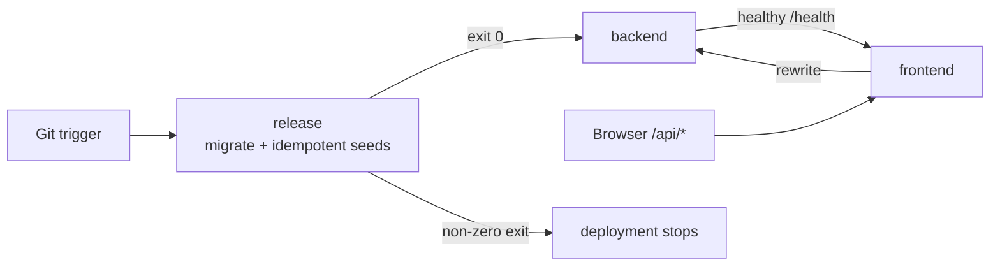

# Deployment

> TailorTales deploys through **[Dokploy](https://dokploy.com)** as one Compose resource per
> environment. UAT and production use the same
> [`deploy/docker-compose.yml`](../../deploy/docker-compose.yml); only their Dokploy environment
> values and Git triggers differ.

## Compose topology

The root [`docker-compose.yml`](../../docker-compose.yml) remains local-development
infrastructure (Postgres, Redis, and MinIO). It is not the Dokploy deployment definition.



`release` is a one-shot service built from `backend/Dockerfile.release`. On every deployment it
runs, in order:

```bash
pnpm --filter backend db:migrate:deploy
pnpm --filter backend seed:art-styles
pnpm --filter backend seed:pricing-tiers
pnpm --filter backend seed:story-blueprints
```

The shell exits on the first failure. Compose starts `backend` only after `release` succeeds,
then starts `frontend` only after the backend health check passes. This is automatic: nobody
manually runs migrations or presses a second deploy button.

The blueprint seed creates or reuses a non-login `TailorTales System` user solely as the
required audit owner for built-in blueprints. Therefore a clean environment receives the Book
and Comic blueprints on its first deployment; it does not need an OAuth user or an administrator
before story generation works.

UAT and production keep their Dokploy-managed PostgreSQL and Redis services; UAT also has a
persistent MinIO resource. All Compose services join the external `dokploy-network`; no
application port is published directly on the VPS. Dokploy/Traefik routes application domains
to ports `3000` and `3001`.

> A migration and application rollout cannot be globally atomic. Every schema migration shipped
> through this flow must therefore be backward-compatible with the currently running backend
> (expand first, deploy code, contract in a later release).

## Images

### Backend (`backend/Dockerfile`)

| Stage   | What it does                                                                                           |
| ------- | ------------------------------------------------------------------------------------------------------ |
| `deps`  | Installs production-only dependencies; skips Puppeteer's bundled-browser download.                     |
| `build` | Installs all dependencies, generates the Prisma client, then compiles it with the backend.             |
| `run`   | Copies runtime files and `newrelic.cjs`, installs Alpine Chromium for PDF rendering, and exposes 3001. |

The Prisma client is generated at build time with a non-secret dummy URL because Prisma 7
requires the variable while loading its config; no database connection is opened.
The real `DATABASE_URL` is required only by `release` and the running backend.

### Release (`backend/Dockerfile.release`)

Installs the backend tooling and source needed by Prisma migrations and idempotent seed scripts.
It is separate from the lean backend runtime image and never serves traffic.

### Frontend (`frontend/Dockerfile`)

Next.js `NEXT_PUBLIC_*` values are compiled into browser bundles during `next build`. The
Dockerfile therefore declares them as build arguments, while Compose also supplies them at
runtime for server-rendered code. Changing a public value requires a new image build.

`SENTRY_AUTH_TOKEN` is a build-only secret used to upload source maps. Compose exposes it to the
single `next build` instruction as a BuildKit secret; it is absent from image layers and the
frontend runtime environment. Compose also fixes `SENTRY_SOURCE_MAP_UPLOAD_REQUIRED=true`, so a
Dokploy build without the token fails instead of silently shipping minified stack traces. Direct
local image builds leave that build arg at its `false` default and may skip the upload.

## Environment contract

Paste a complete copy of [`deploy/.env.example`](../../deploy/.env.example) into each Dokploy
Compose environment and replace every `CHANGE_ME` value. Do not commit real values.

The Compose file deliberately reduces duplicate inputs:

| Dokploy input        | Backend use                           | Frontend use                     |
| -------------------- | ------------------------------------- | -------------------------------- |
| `BACKEND_URL`        | Public same-origin API base (`…/api`) | —                                |
| `FRONTEND_URL`       | CORS/frontend origin                  | `NEXT_PUBLIC_SITE_URL`           |
| `PADDLE_ENVIRONMENT` | Paddle server SDK                     | `NEXT_PUBLIC_PADDLE_ENV`         |
| `SENTRY_ENVIRONMENT` | Backend event tag                     | `NEXT_PUBLIC_SENTRY_ENVIRONMENT` |

Browser requests use the fixed same-origin `/api` base. Next.js rewrites those requests to
`http://backend:3001` on the Compose network; server-rendered code calls that internal URL
directly and forwards the incoming session cookie. This keeps the host-only auth cookie visible
to both browser and SSR without sharing it with sibling subdomains. `BACKEND_INTERNAL_URL` is
fixed in Compose and is not a Dokploy input.

Shared remote-runtime invariants (`NODE_ENV=production`, real-service stub flags off, Sentry on,
and the New Relic loader enabled) are fixed in Compose rather than copied into every Dokploy
environment.

`NODE_ENV=production` is correct for both remote profiles: it selects optimized framework
runtime behavior, not the business environment. These values select UAT versus production:

| Input                | UAT                                   | Production                    |
| -------------------- | ------------------------------------- | ----------------------------- |
| `BACKEND_URL`        | `https://uat.tailortales.app/api`     | `https://tailortales.app/api` |
| `FRONTEND_URL`       | `https://uat.tailortales.app`         | `https://tailortales.app`     |
| `DATABASE_URL`       | dedicated UAT database                | dedicated production database |
| `REDIS_URL`          | UAT database/index                    | production database/index     |
| `PADDLE_ENVIRONMENT` | `sandbox`                             | `production`                  |
| `STORAGE_ENDPOINT`   | public UAT MinIO API origin           | absent; AWS regional endpoint |
| `STORAGE_BUCKET`     | MinIO `tailortales-uat`               | S3 `tailortales-prod`         |
| `SENTRY_ENVIRONMENT` | `uat`                                 | `production`                  |
| `NEW_RELIC_APP_NAME` | `TailorTales-UAT`                     | `TailorTales-Prod`            |
| `GA`                 | `NEXT_PUBLIC_GA_MEASUREMENT_ID` empty | production GA4 measurement ID |
| `E2E_TEST_SECRET`    | opaque UAT-only secret                | omit                          |

Credentials, OAuth clients, webhook secrets, and Paddle catalog IDs also use their
environment-specific values from the Phase 19 matrix.

When UAT uses `AUTH_ALLOWED_EMAILS`, configure an `app-uat` service-level override containing
the owner emails and `e2e-smoke@tailortales.invalid`. This is required because the JWT strategy
checks the allowlist for the authenticated smoke user on every request. Do not add that technical
email to production.

For UAT, `STORAGE_ENDPOINT=https://storage-uat.tailortales.app` and
`STORAGE_FORCE_PATH_STYLE=true`. That domain routes to the MinIO API on port `9000`; presigned
URLs embed this endpoint, so an internal Docker hostname would not work in browsers. Keep the
MinIO console on port `9001` private. In production, omit both variables so the AWS SDK uses the
regional S3 endpoint. The complete variable reference and build/runtime classification is in
[environment-variables.md](environment-variables.md).

## Dokploy resources and triggers

Create two Compose resources pointing to `deploy/docker-compose.yml`:

| Resource   | Git ref / trigger                    | Environment values |
| ---------- | ------------------------------------ | ------------------ |
| UAT        | `main`; auto-deploy on every merge   | UAT/sandbox values |
| Production | explicit SemVer tag such as `v1.0.0` | live values        |

Do not configure separate backend/frontend auto-deploy webhooks. The Compose resource owns the
ordered release and both application services as one deployment unit.

## Safe UAT cutover

Do not delete the existing `backend-uat` and `frontend-uat` applications before validation:

1. Disable their automatic deploy triggers, but leave the running containers and domains intact.
2. Provision persistent UAT MinIO, route `storage-uat.tailortales.app` to API port `9000`, and
   keep its console private.
3. Create the new UAT Compose resource from the same Git revision.
4. Add the full UAT env set and deploy with temporary backend/frontend domains.
5. Verify `release` exited `0`, `GET /api/health` is healthy, OAuth works through the
   same-origin callback, and one story reaches PDF generation.
6. Move the real UAT domains from the old applications to the Compose services.
7. Run the smoke checklist again through the real domains.
8. Delete the old `backend-uat` and `frontend-uat` applications only after the new route is
   proven. Keep the Dokploy PostgreSQL, Redis, and MinIO resources.

Rollback means redeploying a previously known-good Git revision. Because database migrations
remain applied, rollback is safe only while migrations follow the expand-contract rule.

## CI pipeline

`.github/workflows/ci.yml` runs on every push and pull request to `main`:

| Step                   | Command           | Notes                                            |
| ---------------------- | ----------------- | ------------------------------------------------ |
| Install                | `pnpm install`    | Frozen lockfile; uses `.nvmrc` for Node version. |
| Generate Prisma client | `db:generate`     | Uses a dummy `DATABASE_URL`; no live DB needed.  |
| Lint + format check    | `pnpm check`      | ESLint + Prettier.                               |
| Type-check             | `pnpm type-check` | Type-checks both packages.                       |
| Test                   | `pnpm test`       | Vitest with external-service stubs.              |

CI does not deploy individual applications. Dokploy receives the configured Git trigger and
builds the Compose services from the repository.

## Post-deploy UAT gate

UAT browser smoke must run **after the deployment for the merged `main` revision has succeeded**.
It is a release gate, not a pull-request check: a PR does not yet exist on UAT, and a health check
alone does not prove that browser routing or the authenticated UI work.

```mermaid
sequenceDiagram
    participant GH as GitHub Actions
    participant D as Dokploy UAT Compose
    participant U as uat.tailortales.app

    GH->>D: deploy main SHA
    GH->>D: poll that deployment until succeeded
    GH->>U: Playwright public + authenticated smoke
    alt smoke passes
        GH-->>GH: mark main SHA `UAT E2E` successful
        GH-->>GH: release promotion may create production tag
    else deploy or smoke fails
        GH-->>GH: fail deploy-verified; no production promotion
    end
```

Use one deploy owner. GitHub Actions owns UAT: `.github/workflows/deploy-uat.yml` runs on every
push to `main`, calls the Dokploy Compose deploy API, and polls the deployment before starting
browser smoke. Dokploy's UAT `On Push` trigger must remain disabled; otherwise its webhook races
the workflow and may cause the smoke suite to test the wrong revision.

The workflow requires these GitHub repository secrets/variables:

| Name                      | Kind     | Purpose                                                                           |
| ------------------------- | -------- | --------------------------------------------------------------------------------- |
| `DOKPLOY_URL`             | Variable | `https://dokploy.tailortales.app`; API base for the workflow.                     |
| `DOKPLOY_API_TOKEN`       | Secret   | Calls the Dokploy API; never expose in logs.                                      |
| `DOKPLOY_UAT_COMPOSE_ID`  | Variable | Identifies the UAT Compose resource.                                              |
| `CF_ACCESS_CLIENT_ID`     | Secret   | Cloudflare Access service-token client ID for the protected Dokploy API.          |
| `CF_ACCESS_CLIENT_SECRET` | Secret   | Cloudflare Access service-token secret for the protected Dokploy API.             |
| `E2E_TEST_SECRET`         | Secret   | Authenticates the UAT-only test-session endpoint. Must equal UAT Dokploy's value. |
| `PLAYWRIGHT_BASE_URL`     | Variable | `https://uat.tailortales.app`.                                                    |

`deploy-uat.yml` also supports `workflow_dispatch`. It refuses to deploy if another UAT deployment
is already running or `main` has advanced beyond the selected SHA. It then calls `compose.deploy`,
waits for Dokploy's Compose status to transition through `running` to `done`, and runs
`pnpm test:e2e`. On failure it uploads the Playwright report, trace, and screenshots.

`deploy-prod.yml` is a manual promotion workflow named **Deploy to PROD**. It accepts an exact
`main` SHA and a stable SemVer tag, verifies the `UAT E2E` check for that SHA, then creates the
annotated tag. Until the production Dokploy Compose resource is configured to track SemVer tags,
this intentionally stops at tagging and does not deploy production. Do not create production tags
directly from a developer machine. GitHub repository settings must allow workflows to have
**Read and write permissions**, otherwise the workflow cannot create the tag.
