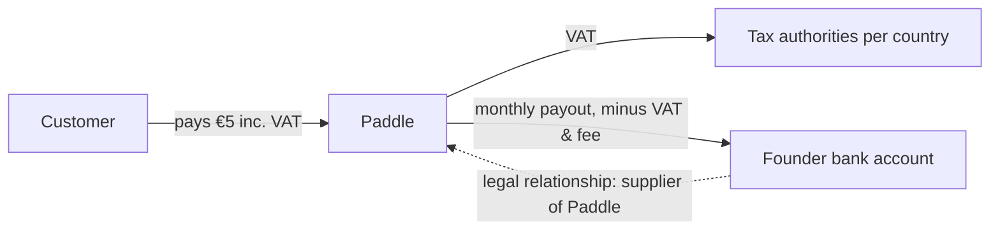

# Phase 9 — Billing Finances (Paddle MoR model)

> Working notes captured during Phase 9.

## Merchant of Record model



- **Paddle is the legal seller** (merchant of record). The customer's invoice and card statement
  say Paddle. We are Paddle's supplier — our only legal counterparty is Paddle, never the end
  customer.
- **PCI**: card data never touches our code — that's why the overlay checkout is barely
  customizable (brand color + theme only; full branding requires inline checkout, see Post-MVP).
- **VAT/sales tax**: collected from the customer, filed, and remitted by Paddle in every
  jurisdiction. No VAT OSS registration, no per-country filings on our side.

## What Paddle costs

No subscription — **per-transaction fee: 5% + $0.50** (standard public pricing). Covers payment
processing (cards, PayPal, Apple Pay…), tax compliance, fraud protection, chargebacks, billing
infra.

Worked example — €5 Story Hour, customer in Germany (19% VAT), **tax-inclusive** pricing:

```
Customer pays:            €5.00   (inc. VAT — our catalog prices are tax-inclusive)
− VAT 19% (to the state): €0.80
− Paddle 5% + $0.50:     ~€0.71
──────────────────────────────────
Net payout:              ~€3.49   (~70%)
```

Notes:

- Tax-inclusive vs tax-exclusive is configured **per price** in the Paddle catalog. Inclusive =
  customer always sees €5; VAT comes out of it (net varies by country).
- The fixed $0.50 disproportionately hurts low prices (~10% extra on a €5 plan; much lighter on
  €10). Argument for the future pricing revision and for annual plans (one large transaction).
- Payouts are monthly to a bank account.
- Stripe-style processors charge ~2–3% but leave the entire tax compliance burden to the seller —
  for a solo founder selling globally, MoR is the right trade.

## Action items (feed into Phase 15)

- [ ] Decide tax-inclusive vs tax-exclusive pricing per tier before creating the live catalog
